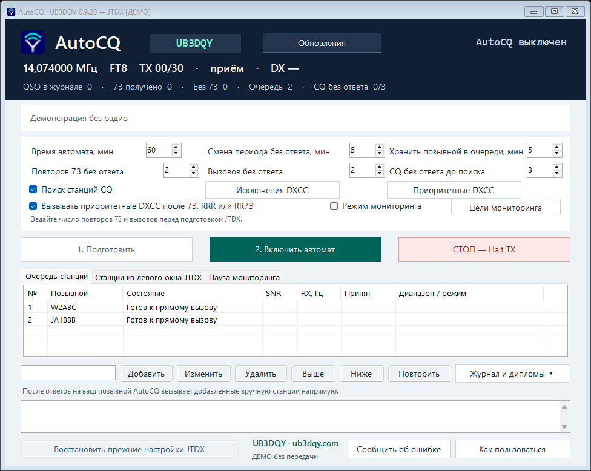
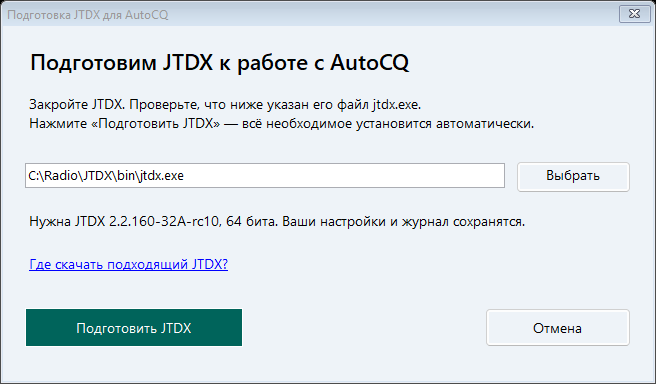
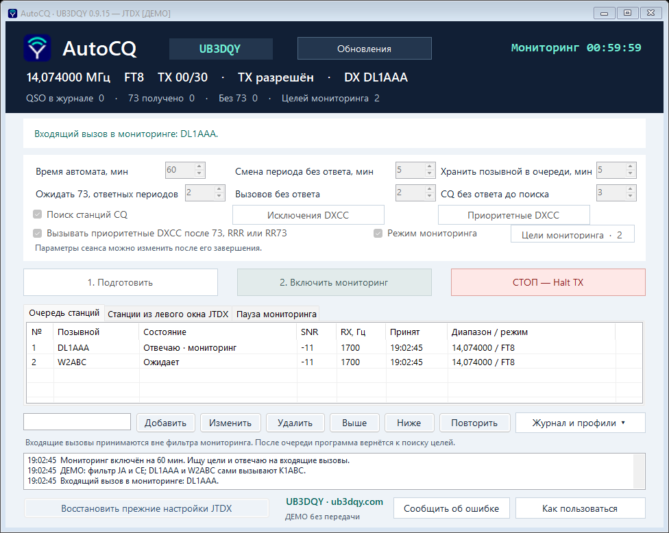
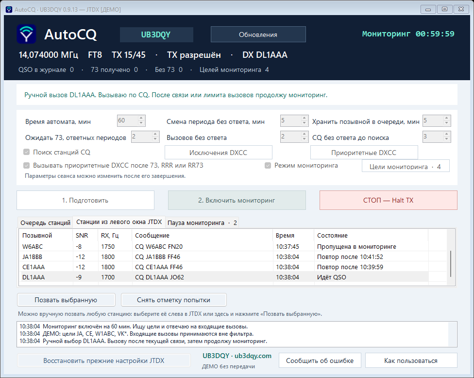
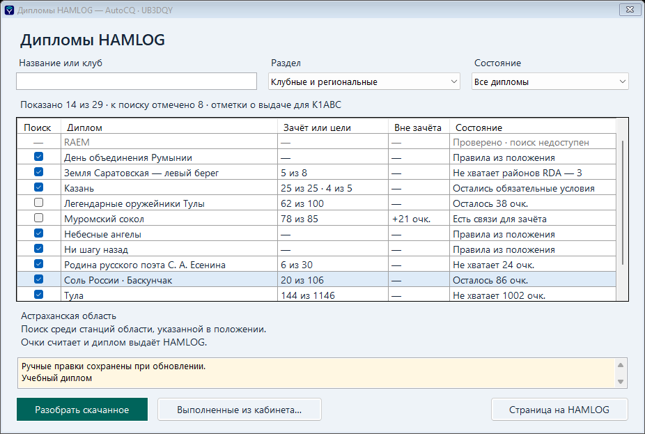
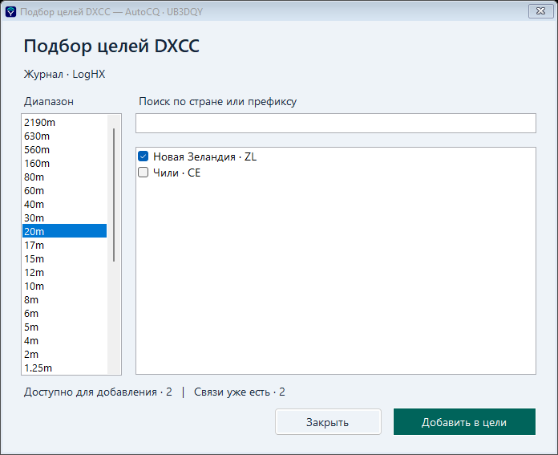
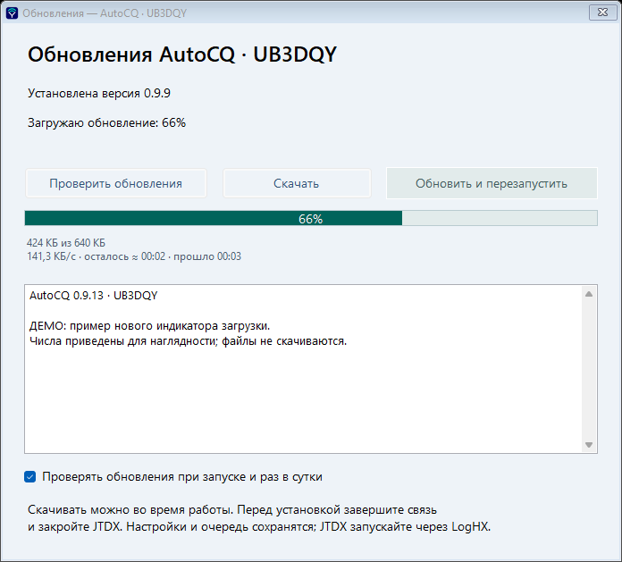
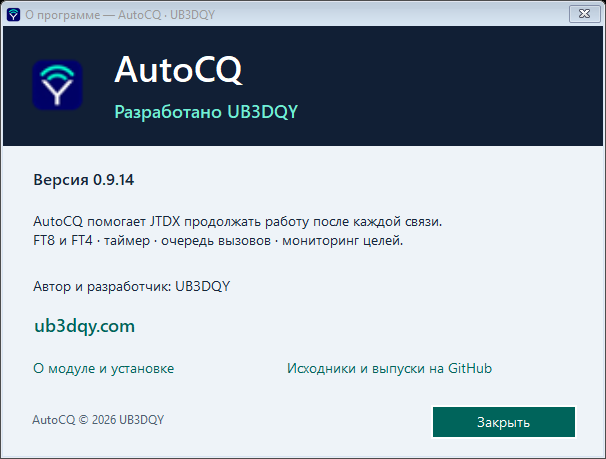
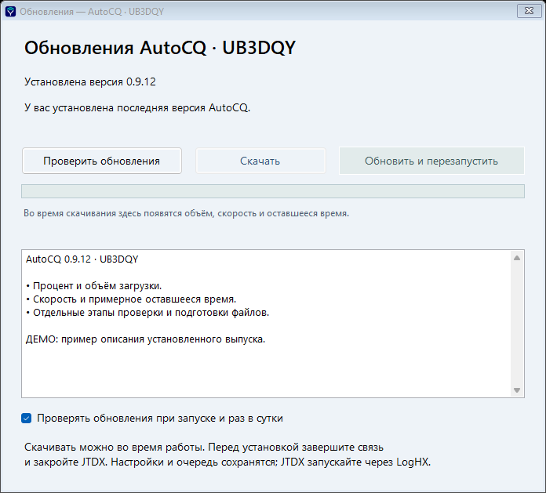
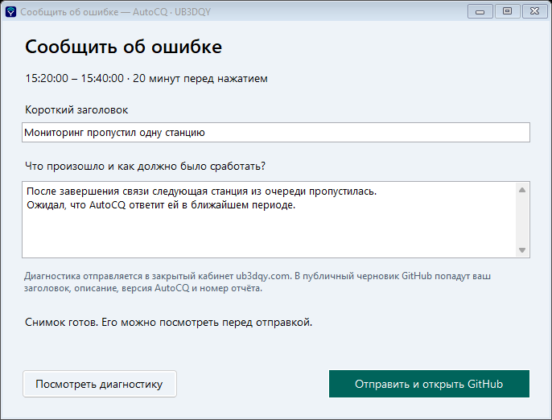

# AutoCQ · UB3DQY — for JTDX

[Русский](README.md) · [Download AutoCQ](https://github.com/ub3dqy/jtdx-autocq/releases/latest) · [User guide](USER-GUIDE.en.md) · [AutoCQ on UB3DQY](https://ub3dqy.com/ru/read/5/)

**AutoCQ keeps JTDX working after a contact ends.** It can answer the next caller or call CQ again. You decide whom to call, how long to wait and how long the session lasts. AutoCQ supports FT8 and FT4.

You could let it work for an hour, answering callers and looking for another station when nobody replies. Or enable monitoring: AutoCQ watches for wanted countries and callsigns, and also answers stations that call you.

## What AutoCQ can do

- **Continue after each QSO.** Answer callers, return to CQ and alternate CQ with calling another station.
- **Finish the exchange.** AutoCQ repeats the sign-off each time the current station sends another report. When the station goes quiet, it sends the configured number of retries and listens for a reply after each.
- **Work to a timer.** Finish the current contact and handle available queued callers when time runs out.
- **Follow your preferences.** Prioritize selected DXCC entities, skip excluded entities and answer new stations first when several call together.
- **Keep a queue.** Remember callers while you are busy. Manually added callsigns are called directly after the current contact and available incoming callers.
- **Make a manual call while monitoring.** Choose an interesting station outside the target list. After that contact, AutoCQ resumes monitoring with the same settings and time remaining.
- **Watch for wanted stations.** Match DXCC entities, callsigns and patterns against fresh CQ, 73, RRR or RR73. Return to receive after the contact or attempt limit.
- **Work with HAMLOG awards.** AutoCQ downloads the catalog and rules, checks your credit, and looks for the contacts you still need for an award, including its next open tier.
- **Answer incoming calls in every mode.** A station calling you takes priority over the next CQ or outgoing call. Fresh calls from stations you have already worked can join the queue. AutoCQ skips stations on your DXCC exclusion list.
- **Update from the application.** Notify you about new releases and show download percentage, transferred size, speed and estimated time remaining. Install when you choose.
- **Show monitoring retry pauses.** List unanswered stations with a countdown to their next eligible attempt. Stopping monitoring clears the list.

Audio, radio control, filters and left-pane clearing remain JTDX settings. The current interface is in Russian; the guide translates the button labels.

If retuning stops a session, AutoCQ shows the old and new frequencies and the difference in hertz. The reason appears in the main window and the log.

## What you need

**64-bit Windows**, .NET Framework 4.x and **JTDX 2.2.160-32A-rc10 Win64**. Check both `32A` and `64-bit` in the build name. Other rc10 variants are not compatible.

You can use a SunSDR or another radio that already works with JTDX. The built-in JTDX log is supported; external logging has been tested with LogHX. **When using LogHX, start JTDX from its icon in LogHX.**

## Getting started

1. Install [JTDX 32A, 64-bit](https://ub3dqy.com/downloads/jtdx/2.2.160-rc10/jtdx-2.2.160-32A-rc10-win64.exe.zip). Set up your callsign, audio and radio, check normal operation, then close JTDX.
2. Open the [latest AutoCQ release](https://github.com/ub3dqy/jtdx-autocq/releases/latest), expand **Assets** and download **JTDX-AutoCQ-…-win64.zip**, rather than “Source code”.
3. In File Explorer, right-click the ZIP and choose **Extract All**. Put AutoCQ in its own folder, for example under Documents. Run it from the extracted folder.
4. Open **JTDX-AutoCQ.exe** and click **«1. Подготовить»** (Prepare). On first use, check the path to `jtdx.exe`, click **«Подготовить JTDX»** (Prepare JTDX), then **«Продолжить»** (Continue). Approve a Windows permission prompt if needed.
5. Start JTDX as usual, **through LogHX** if that is your logger. Choose a band and FT8 or FT4. Wait for the frequency to appear in AutoCQ.
6. Set a duration and click **«2. Включить автомат»** (Enable automatic operation). For a first check, try 5 minutes, 2 call attempts and 2 sign-off retries after no reply.

Setup installs the JTDX integration and keeps the original executable beside it. Ordinary installation no longer needs Node.js or commands. See the [user guide](USER-GUIDE.en.md) for screenshots and common questions. **«Как пользоваться»** opens the Russian offline guide; the English guide is in the same folder.

To preview without a radio, run `JTDX-AutoCQ.exe --demo`. Demo mode uses sample data and never transmits.

## Monitoring wanted stations

Open **«Цели мониторинга»** (Monitoring targets), select DXCC entities and add callsigns or patterns such as `9J*`. Enable **«Режим мониторинга»**, then **«2. Включить мониторинг»**. AutoCQ waits for fresh CQ, 73, RRR or RR73 from matching stations in the left pane. For a sign-off, the sender is selected.

**«Одна связь на цель на диапазоне»** means one contact per selected target per band. If Japan is a DXCC target and your log already contains a Japanese contact on 20 m, that country target is complete on 20 m. Clear the checkbox to call more Japanese stations on that band. Exact callsign and pattern targets are checked against their own matches. DXCC exclusions also apply.

When another station calls you, AutoCQ answers regardless of the monitoring targets. Calls received during a QSO stay in the queue: the current contact finishes first, then AutoCQ answers callers and resumes monitoring. This also works when a new call arrives alongside the final 73. The one-contact-per-target limit and a failed-search pause do not block an incoming caller; DXCC exclusions still apply.

If JTDX ends a call because the frequency is occupied or the other station answers someone else, AutoCQ returns to receive. Monitoring keeps its original end time.

Spotted an interesting station outside your targets? While monitoring is listening, double-click its message in JTDX. You can also select it in AutoCQ's **«Станции из левого окна JTDX»** tab and click **«Позвать выбранную»** (Call selected). After the contact or the unanswered-call limit, monitoring resumes with the original settings and time remaining. The manual choice applies once; DXCC exclusions still apply.

## Main logbook, profiles and session results

Open **«Журнал и дипломы»** (Logbook and awards) to select your LogHX logbook or an ADIF export from another program. AutoCQ uses that history, including voice and contacts made through other software. In **«Подбор целей DXCC»** (Find DXCC targets), select a band and tick the entities that you still need on that band.

In **«Дипломы HAMLOG»** (HAMLOG awards), click **«Обновить каталог»** (Update catalog). If **«Разобрать скачанное»** (Process downloaded rules) appears after an AutoCQ update, click it to process your saved documents first. Filter for awards available for search, tick the awards you want, close the window, and choose **«Журнал и дипломы → Мониторинг дипломов»** (Logbook and awards → Award monitoring).

Double-click an award to see its search rules. For Saratov Land, the editor shows the list of districts on the left bank. For Tula, AutoCQ multiplies the contact points by the number of different districts worked. **«Зачёт и надбавки»** (Required contacts and bonuses) explains how that score is calculated. [How to prepare awards and start monitoring](USER-GUIDE.en.md#search-for-hamlog-award-contacts)

Select a reviewed award whose search is unavailable to see the reason below the list. For example, a river award needs the reference of the river the station is activating.

Nationwide RDA searches cover European Russia, Asiatic Russia and Kaliningrad. For regional awards, AutoCQ selects callsigns in the relevant region. HAMLOG checks contacts, calculates credit and issues awards.

Some awards give extra points on particular dates or for certain callsigns. For the Yesenin award, contacts score more points from October 1 to 7, and three contacts on October 3 are enough to qualify. Double-click the award and open **«Зачёт и надбавки»** (Required contacts and bonuses) to see those conditions.

After an interruption, **«Продолжить загрузку»** (Resume download) uses documents already downloaded. The AutoCQ log shows the reason for the interruption.

The same menu lets you save settings under a name and check **«Итоги сеанса»** (Session results). The results show final confirmations and which records were found in your main logbook. If a callsign remains in the left list, select it and click **«Почему пропущена?»** (Why was this station skipped?).

## Updates

Version 0.9.6 introduces **«Обновления»** (Updates). AutoCQ checks GitHub at startup and daily while open. A new version highlights the button and shows a notification. You can disable automatic checks.

Checking and downloading can happen during operation. To install, finish the contact and close JTDX, then click **«Обновить и перезапустить»** (Update and restart). LogHX can stay open. AutoCQ updates its files and the JTDX integration when needed. Launch JTDX from LogHX afterwards. The queue, AutoCQ settings and JTDX profile are preserved.

During downloading, the bar fills as the file arrives. It shows the received and total size, speed and estimated time remaining. At 100%, AutoCQ separately verifies the archive and prepares the installation files. If the server does not provide a total size, the window shows received bytes and elapsed time.

**To upgrade from 0.9.5 or earlier**, close JTDX and AutoCQ, download the new archive and extract it over the previous folder. Open the new `JTDX-AutoCQ.exe` and click Prepare. AutoCQ will update the JTDX integration.

## Author and website

AutoCQ is developed by amateur radio operator **UB3DQY**. Visit [ub3dqy.com](https://ub3dqy.com/) for the author's radio projects and the [AutoCQ page](https://ub3dqy.com/ru/read/5/) for an overview and installation information.

The author's callsign appears at the top of the application. Click it to open **«О программе»** (About), where you can find the version, website, project description, source code and releases. The link at the bottom of the main window opens the author's website directly.

## Help, bugs and ideas

Click **«Сообщить об ошибке»** (Report a bug) when something goes wrong. AutoCQ captures the preceding 20 minutes of diagnostics. Describe what happened and choose where to send the report.

- **«Отправить в поддержку»** (Send to support) sends your description and diagnostics to the private staff area at ub3dqy.com. You can send it without an account.
- **«Отправить и открыть GitHub»** (Send and open GitHub) sends the diagnostics to the private area and opens an issue draft with your description and report number. Sign in to GitHub to review and publish it.

- [Report a bug or suggest a feature](https://github.com/ub3dqy/jtdx-autocq/issues/new/choose) using the English or Russian forms.
- [Ask a question or share experience](https://github.com/ub3dqy/jtdx-autocq/discussions).
- [Contributing](CONTRIBUTING.md).

A free GitHub account is required to post in Issues or Discussions. If you post manually, add your version, a description and a short log excerpt around the event.

## Download JTDX 2.2.160-rc10 for Windows

| JTDX build | Use |
| --- | --- |
| [32A, 64-bit](https://ub3dqy.com/downloads/jtdx/2.2.160-rc10/jtdx-2.2.160-32A-rc10-win64.exe.zip) | **Required for AutoCQ** |
| [32A, 32-bit](https://ub3dqy.com/downloads/jtdx/2.2.160-rc10/jtdx-2.2.160-32A-rc10-win32.exe.zip) | Standalone JTDX |
| [Standard, 64-bit](https://ub3dqy.com/downloads/jtdx/2.2.160-rc10/jtdx-2.2.160-rc10-win64.exe.zip) | Standalone JTDX |
| [Standard, 32-bit](https://ub3dqy.com/downloads/jtdx/2.2.160-rc10/jtdx-2.2.160-rc10-win32.exe.zip) | Standalone JTDX |

[Original EcoAlfa page](https://ecoalfa.org/recursos/jtdx.4/) — login required. [Release notes and installer SHA-256 checksums](https://ecoalfa.org/recursos/jtdx.4/updates#resource-update-7). See also [ub3dqy.com](https://ub3dqy.com/ru/read/5/).

SHA-256 of the extracted `jtdx-2.2.160-32A-rc10-win64.exe` installer:
`67276B42561E3D1722BACABBA39B8B467C21BDFB73E4EEBFD832AB6152122574`.
Each AutoCQ release includes its archive checksum in `SHA256SUMS.txt`; the built-in updater verifies it automatically.

The award document reader uses PdfPig and .NET libraries. [PdfPig license](docs/pdfpig-license.md) · [.NET license](docs/dotnet-license.md)

## For developers

`build.ps1` compiles with .NET Framework tools. `build.ps1 -Test` runs offline checks; `-JtdxBin` also checks the native patch without starting JTDX or transmitting. Node.js and NASM are only needed for work on native patch sources.

See [AGENTS.md](AGENTS.md) for the release process. Feature releases must update Russian and English documentation, user guides and genuine demo screenshots.

## License

No separate AutoCQ license has been specified yet. JTDX is a project by Igor Chernikov UA3DJY, Arvo Järve ES1JA and the community, distributed under [GNU GPLv3](https://www.gnu.org/licenses/gpl-3.0.html). [JTDX source](https://github.com/jtdx-project/jtdx).
