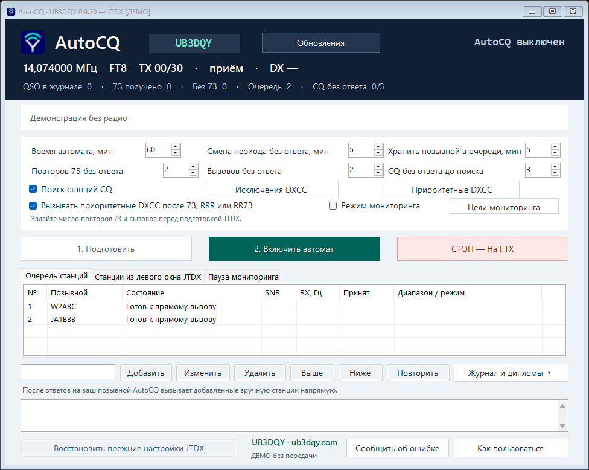
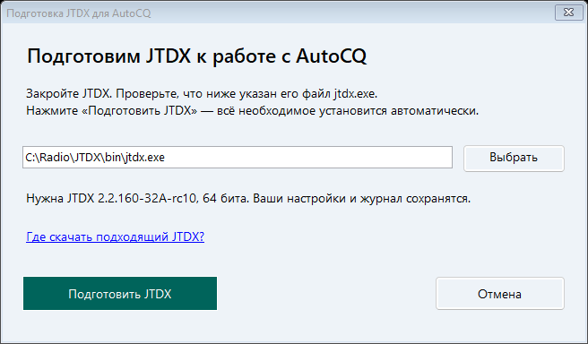
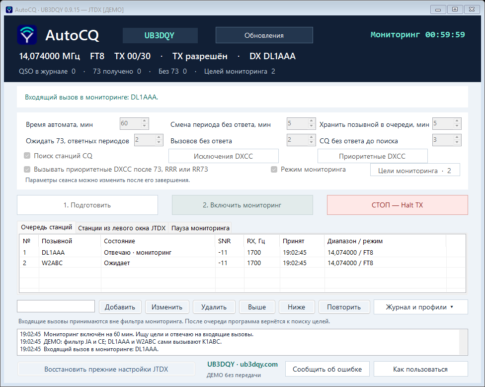
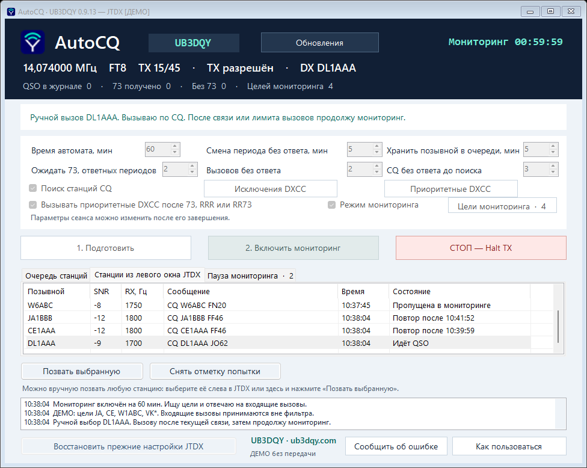
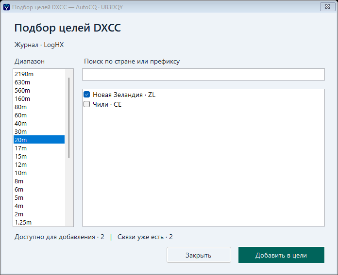
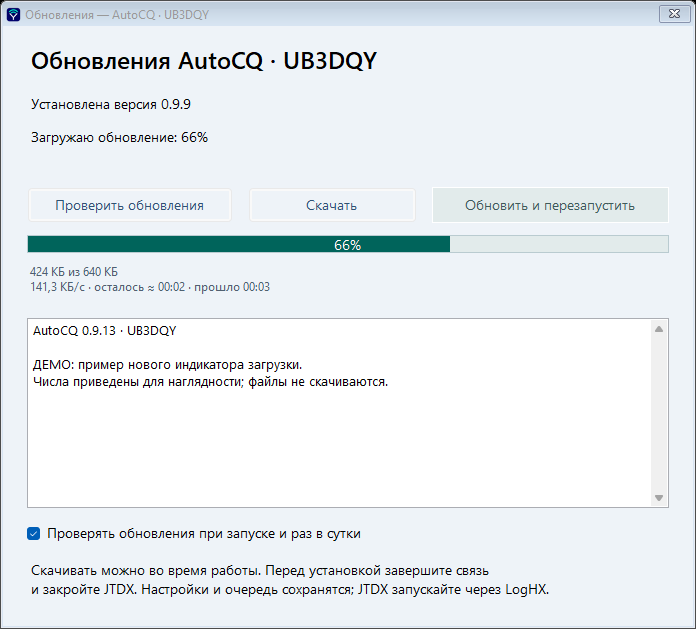
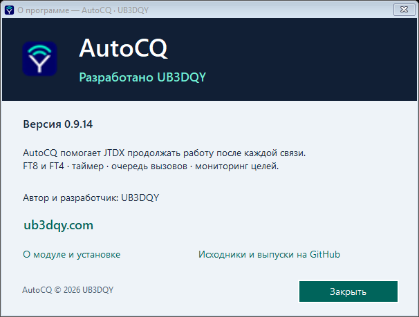
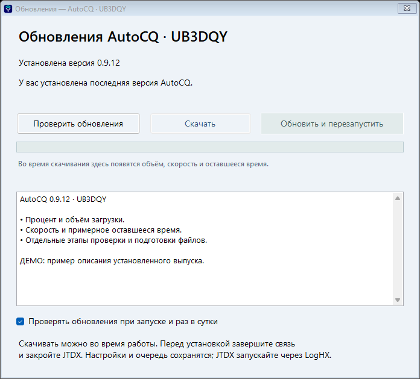
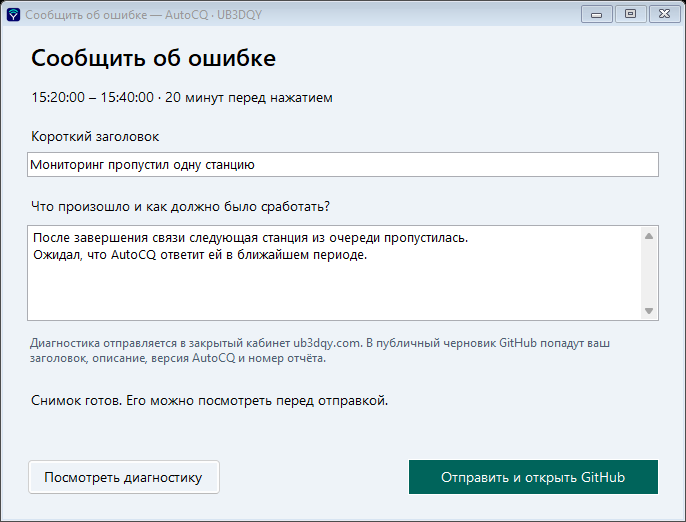

# AutoCQ · UB3DQY — для JTDX

[English](README.en.md) · [Скачать AutoCQ](https://github.com/ub3dqy/jtdx-autocq/releases/latest) · [Руководство](USER-GUIDE.md) · [Статья на UB3DQY](https://ub3dqy.com/ru/read/5/)

**С AutoCQ программа JTDX продолжает работать после завершения радиосвязи.** Она сама отвечает следующему корреспонденту или снова даёт общий вызов. Вы выбираете, кого звать, сколько ждать ответа и сколько времени работать в эфире. Модуль поддерживает FT8 и FT4.

Например, можно задать час работы, отвечать всем вызывающим, а при отсутствии ответов искать станции из левого окна JTDX. Или включить мониторинг: программа будет искать нужные страны и позывные, а также отвечать станциям, которые сами вас зовут.

## Что умеет AutoCQ

- **Продолжать работу после QSO.** Отвечать вызывающим, возвращаться к CQ и чередовать общий вызов с поиском станции.
- **Дождаться завершения обмена.** На каждый новый рапорт от текущего корреспондента AutoCQ повторяет завершающее сообщение. Когда корреспондент замолкает, модуль делает заданное число повторов и даёт ему ответить после каждого.
- **Работать по таймеру.** По окончании времени завершать текущую связь и обрабатывать доступные вызовы очереди. Передача посреди QSO не обрывается.
- **Учитывать ваши предпочтения.** Выбирать приоритетные DXCC, пропускать страны из исключений и сначала отвечать новым корреспондентам, если зовут несколько станций.
- **Вести очередь.** Запоминать вызывающих, пока вы заняты. Вручную добавленный позывной вызывается напрямую после текущей связи и доступных вызывающих.
- **Искать нужные цели.** В мониторинге выбирать страны DXCC, позывные и маски по свежим CQ, 73, RRR или RR73. После связи или лимита попыток снова переходить на приём.
- **Работать с каталогом дипломов HAMLOG.** Загружать общий каталог, открывать положения и скрывать выданные дипломы по файлу из вашего кабинета. Для карточек с готовыми правилами AutoCQ сверяет зачёт и подбирает связи, которых ещё не хватает.
- **Отвечать на входящие во всех режимах.** Когда станция зовёт вас, AutoCQ ставит её в очередь и отвечает раньше следующего CQ или исходящего вызова. Свежие повторные вызовы тоже учитываются. Станции из исключений DXCC пропускаются.
- **Вызывать станцию вручную во время мониторинга.** Можно выбрать интересный позывной за пределами списка целей. После этой связи AutoCQ продолжит мониторинг с прежними настройками и оставшимся временем.
- **Обновляться из своего окна.** Сообщать о новой версии и показывать ход скачивания: процент, объём, скорость и примерное время до окончания загрузки. Устанавливать обновление по вашей команде.
- **Показывать паузы мониторинга.** Выводить станции, которые не ответили, с отсчётом времени до следующей попытки. При остановке мониторинга список очищается.

Все основные параметры задаются в окне модуля. Настройки звука, трансивера, фильтра и очистки левого окна остаются в JTDX.

Если сеанс остановился после перестройки, AutoCQ покажет прежнюю и новую частоту и разницу в герцах. Причину можно посмотреть в окне модуля и в журнале.

## Что понадобится

Windows **x64** с .NET Framework 4.x и **JTDX 2.2.160-32A-rc10 Win64**. Обратите внимание на `32A` и `64 бита`: другие варианты rc10 для AutoCQ не подходят.

Подойдёт SunSDR или другой трансивер, с которым у вас уже работает JTDX. Можно использовать журнал JTDX; передача связей во внешний журнал проверена с LogHX. **Если пользуетесь LogHX, запускайте JTDX через его значок в LogHX.**

## Установка за несколько шагов

1. Установите подходящую [сборку JTDX 32A, 64 бита](https://ub3dqy.com/downloads/jtdx/2.2.160-rc10/jtdx-2.2.160-32A-rc10-win64.exe.zip). Настройте позывной, звук и трансивер, проверьте обычную работу и закройте JTDX.
2. На [странице последнего выпуска AutoCQ](https://github.com/ub3dqy/jtdx-autocq/releases/latest) раскройте **Assets** и скачайте **JTDX-AutoCQ-…-win64.zip**. Выберите этот архив, а не «Source code».
3. В Проводнике нажмите на архив правой кнопкой → **«Извлечь всё»**. Поместите программу, например, в отдельную папку AutoCQ в «Документах». Открывать её прямо внутри ZIP не нужно.
4. Запустите **JTDX-AutoCQ.exe** и нажмите **«1. Подготовить»**. При первом запуске появится окно подготовки JTDX. Проверьте путь к `jtdx.exe`, нажмите **«Подготовить JTDX»**, затем **«Продолжить»**. Если Windows запросит разрешение на изменение установленного файла, подтвердите его.
5. Запустите JTDX привычным способом — **через LogHX**, если работаете с этим журналом. Выберите диапазон и FT8 или FT4. В AutoCQ дождитесь появления частоты.
6. Задайте время и нажмите **«2. Включить автомат»**. Для первой проверки подойдут 5 минут, 2 вызова станции и 2 повтора 73 без ответа.

Подготовка устанавливает нужное дополнение к JTDX и сохраняет оригинальный файл рядом с ним. Node.js и ввод команд для обычной установки больше не нужны. Подробности, снимки окон и ответы на частые вопросы есть в [руководстве пользователя](USER-GUIDE.md). В самой программе его открывает кнопка **«Как пользоваться»**.

Для знакомства без трансивера запустите `JTDX-AutoCQ.exe --demo`. Деморежим использует вымышленные примеры и не выходит в эфир.

## Мониторинг нужных станций

Откройте **«Цели мониторинга»**, выберите DXCC, добавьте позывные или маски, например `9J*`. Включите **«Режим мониторинга»**, затем **«2. Включить мониторинг»**. AutoCQ будет ждать подходящее CQ, 73, RRR или RR73 в левом окне JTDX. По прощальному сообщению вызывается станция, которая его передала.

Галочка **«Одна связь на цель на диапазоне»** относится к выбранной цели. Если цель — Япония и в журнале уже есть японская станция на 20 м, эта страна на 20 м считается выполненной. Чтобы вызывать другие станции Японии на том же диапазоне, снимите галочку. Для точного позывного проверяется этот позывной, для маски — соответствующая ей цель. Исключения DXCC действуют и в мониторинге.

Если другая станция сама вас позовёт, AutoCQ ответит ей независимо от целей мониторинга. Вызовы, принятые во время QSO, останутся в очереди: сначала модуль закончит связь, затем ответит вызывающим и продолжит мониторинг. Это работает и когда новый вызов приходит одновременно с финальным 73. Ограничение «Одна связь на цель» и пауза после неудачного поиска не мешают ответить входящему корреспонденту; исключения DXCC сохраняются.

Если JTDX прервёт вызов, потому что корреспондент ответил другому или частота занята, AutoCQ вернётся на приём. Мониторинг продолжится с тем же временем окончания.

Увидели интересную станцию, которой нет среди целей? Пока мониторинг слушает, дважды нажмите на её сообщение в JTDX. Или выберите её во вкладке AutoCQ **«Станции из левого окна JTDX»** и нажмите **«Позвать выбранную»**. Модуль проведёт эту связь и вернётся к мониторингу. При отсутствии ответа сработает обычный лимит попыток. Ручной выбор действует однократно; исключения DXCC сохраняются.

## Основной журнал, профили и итоги

В меню **«Журнал и дипломы»** можно выбрать рабочий журнал LogHX или экспорт ADIF из другой программы. AutoCQ берёт оттуда историю связей, даже если вы проводили их через другой цифровой модуль или голосом. В **«Подборе целей DXCC»** выберите диапазон и отметьте нужные страны, с которыми в основном журнале ещё нет связи.

В **«Дипломах HAMLOG»** нажмите **«Загрузить каталог»**. Чтобы убрать выданные дипломы из списка, загрузите файл через **«Из кабинета»**. Кнопка **«Положение»** открывает условия выбранной программы. Отметьте один или несколько дипломов, по которым готовы условия поиска, и нажмите **«Начать поиск»**. Например, для «Моей России» AutoCQ ищет незачтённые квадраты, а для «Легендарных оружейников Тулы» учитывает диапазон предыдущей связи. [Как загрузить дипломы и запустить поиск](USER-GUIDE.md#поиск-для-дипломов-hamlog)

Здесь же можно сохранить настройки под своим названием и посмотреть **«Итоги сеанса»**. В итогах видны финальные подтверждения и результаты сверки с основным журналом. Если позывной остался в левом списке, выберите его и нажмите **«Почему пропущена?»**.

## Обновления

В версии 0.9.6 появился раздел **«Обновления»**. AutoCQ проверяет GitHub при запуске и раз в сутки, пока программа открыта. Когда выйдет новая версия, кнопка выделится и появится уведомление. Автоматическую проверку можно отключить.

Проверять и скачивать обновление можно во время работы. Для установки завершите связь и закройте JTDX, затем нажмите **«Обновить и перезапустить»**. LogHX можно оставить открытым. AutoCQ обновит свои файлы и при необходимости дополнение JTDX. После обновления запустите JTDX из LogHX. Настройки модуля, очередь и профиль JTDX сохраняются.

Во время скачивания шкала заполняется по мере получения файла. Рядом видно, сколько уже скачано, полный размер, скорость и примерное оставшееся время. После 100% программа отдельно проверит архив и подготовит файлы к установке. Если сервер не передаст полный размер, AutoCQ покажет полученный объём и прошедшее время.

**Если у вас 0.9.5 или старше**, закройте JTDX и AutoCQ, скачайте новый архив и извлеките его в папку программы с заменой файлов. Откройте новый `JTDX-AutoCQ.exe` и нажмите «Подготовить». AutoCQ обновит дополнение для JTDX.

## Автор и сайт

AutoCQ разрабатывает радиолюбитель **UB3DQY**. На [ub3dqy.com](https://ub3dqy.com/) находятся материалы автора, а [на странице модуля](https://ub3dqy.com/ru/read/5/) — описание и сведения об установке.

Позывной UB3DQY виден в шапке программы. Нажмите на него, чтобы открыть **«О программе»**: там указана версия и есть ссылки на сайт, описание, исходники и выпуски. Ссылка внизу главного окна сразу открывает сайт автора.

## Нужна помощь или есть идея?

Если ошибка проявилась во время работы, нажмите **«Сообщить об ошибке»** в AutoCQ. Программа сохранит диагностику за предыдущие 20 минут. Опишите сбой и выберите, куда отправить отчёт.

- **«Отправить в поддержку»** передаст описание и диагностику в закрытый кабинет на ub3dqy.com. Аккаунт не нужен.
- **«Отправить и открыть GitHub»** передаст диагностику в кабинет и откроет черновик с вашим описанием и номером отчёта. Войдите в GitHub, проверьте текст и опубликуйте Issue.

- [Сообщить об ошибке](https://github.com/ub3dqy/jtdx-autocq/issues/new/choose) — выберите форму на русском или английском.
- [Предложить функцию](https://github.com/ub3dqy/jtdx-autocq/issues/new/choose) — опишите, что хотелось бы делать и в какой ситуации это пригодится.
- [Задать вопрос и обсудить работу](https://github.com/ub3dqy/jtdx-autocq/discussions).
- [Как помочь проекту](CONTRIBUTING.md).

Для публикации в Issues и Discussions понадобится бесплатный аккаунт GitHub. При обращении вручную обычно достаточно версии, описания ситуации и небольшого фрагмента журнала со временем события.

## Скачать JTDX 2.2.160-rc10 для Windows

| Сборка JTDX | Для чего подходит |
| --- | --- |
| [32A, 64 бита](https://ub3dqy.com/downloads/jtdx/2.2.160-rc10/jtdx-2.2.160-32A-rc10-win64.exe.zip) | **Для AutoCQ** |
| [32A, 32 бита](https://ub3dqy.com/downloads/jtdx/2.2.160-rc10/jtdx-2.2.160-32A-rc10-win32.exe.zip) | Для самостоятельной работы JTDX |
| [Обычная сборка, 64 бита](https://ub3dqy.com/downloads/jtdx/2.2.160-rc10/jtdx-2.2.160-rc10-win64.exe.zip) | Для самостоятельной работы JTDX |
| [Обычная сборка, 32 бита](https://ub3dqy.com/downloads/jtdx/2.2.160-rc10/jtdx-2.2.160-rc10-win32.exe.zip) | Для самостоятельной работы JTDX |

[Оригинальная страница EcoAlfa](https://ecoalfa.org/recursos/jtdx.4/) требует входа для скачивания. [Примечания к выпуску и SHA-256 установщиков](https://ecoalfa.org/recursos/jtdx.4/updates#resource-update-7). Ссылки и описание AutoCQ также доступны на [ub3dqy.com](https://ub3dqy.com/ru/read/5/).

SHA-256 распакованного установщика `jtdx-2.2.160-32A-rc10-win64.exe`:
`67276B42561E3D1722BACABBA39B8B467C21BDFB73E4EEBFD832AB6152122574`.
Для архива AutoCQ контрольная сумма находится в `SHA256SUMS.txt` того же выпуска; программа проверяет её сама при встроенном обновлении.

## Для разработчиков

`build.ps1` собирает программу средствами .NET Framework. `build.ps1 -Test` запускает автономные проверки. `-JtdxBin` добавляет проверки нативного патча без запуска JTDX и передачи. Node.js и NASM нужны только для работы с исходниками машинного патча, а не пользователям готового архива.

Порядок выпуска описан в [AGENTS.md](AGENTS.md). Каждое расширение возможностей сопровождается обновлением русской и английской документации, руководств и демонстрационных снимков.

## Лицензия

Для AutoCQ отдельная лицензия пока не указана. JTDX — проект Igor Chernikov UA3DJY, Arvo Järve ES1JA и сообщества, распространяемый по [GNU GPLv3](https://www.gnu.org/licenses/gpl-3.0.html). [Исходный проект JTDX](https://github.com/jtdx-project/jtdx).
