# Using AutoCQ

Guide for AutoCQ 0.9.25 · **UB3DQY** · [Русский](USER-GUIDE.md) · [Project overview](README.en.md)

AutoCQ lets JTDX continue after each contact. It remembers callers while you are busy, then answers the next station or calls CQ again. You choose the session length and selection rules.

Monitoring works differently: JTDX listens until a wanted country or callsign appears, calls that station, then returns to receive. The application interface is currently in Russian; this guide includes the labels you will see.

## 1. Downloads

Get [JTDX 2.2.160-32A-rc10, 64-bit](https://ub3dqy.com/downloads/jtdx/2.2.160-rc10/jtdx-2.2.160-32A-rc10-win64.exe.zip) and the [latest AutoCQ release](https://github.com/ub3dqy/jtdx-autocq/releases/latest).

On GitHub, expand **Assets** and download **JTDX-AutoCQ-…-win64.zip**. The “Source code” archives are for developers. Install JTDX, configure your callsign, audio and radio, check normal operation and close it.

Right-click the AutoCQ ZIP in File Explorer and choose **Extract All**. A separate AutoCQ folder under Documents is convenient. Keep the extracted files together.

## 2. Prepare and start

Open **JTDX-AutoCQ.exe** with JTDX closed. For a first check, choose 5 minutes, 2 call attempts and 2 sign-off retries after no reply. Click **«1. Подготовить»** (Prepare).

If the JTDX integration is missing, this window opens:

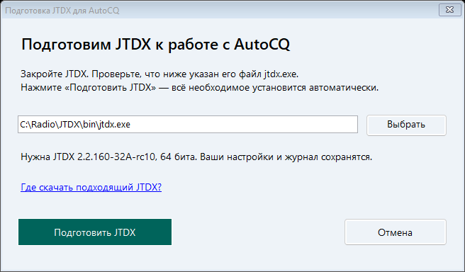

Check the path to the installed **jtdx.exe**. Use **«Выбрать файл»** (Choose file) if needed; it is usually in the JTDX **bin** folder. The supported build is **2.2.160-32A-rc10, 64-bit**. Click **«Подготовить JTDX»** (Prepare JTDX), wait for success, then click **«Продолжить»** (Continue). Approve Windows permission if requested.

The original executable is saved beside jtdx.exe. Your callsign, radio, audio, log and window preferences are preserved. This installation step is skipped on future preparations while the integration is current.

Start JTDX. **When using LogHX, launch it from the JTDX icon inside LogHX.** Select a band and FT8 or FT4. The frequency should appear in AutoCQ within a few seconds, occasionally up to 15 seconds.

Keep JTDX **AutoTX** and its native **AutoSelect** enabled. Leave **Single QSO** disabled. Choose your usual filter and left-pane clearing preferences; AutoCQ does not require “Bypass filters” or a permanently full display.

To begin with CQ, clear the JTDX DX callsign and click **«2. Включить автомат»** (Enable automatic operation).

## 3. The main window

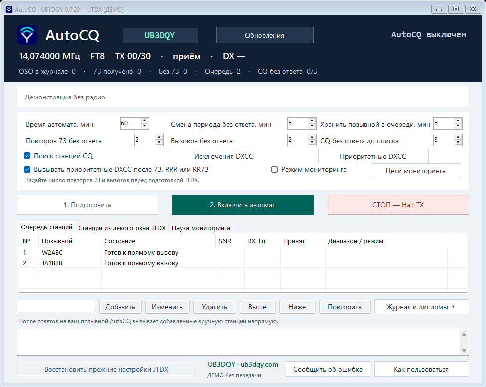

The header shows the connection, frequency, mode, selected station and remaining time. Below it are the current state, settings, start/stop buttons, station queue, received-station list and action log.

**«СТОП — Halt TX»** stops automation and sends an immediate Halt TX command to JTDX. Use the timer for a planned end.

When time runs out, **«Завершаю QSO / очередь»** means the session is still finishing. AutoCQ completes the current exchange and handles available queued callers. Entries marked **«Нет ответа»** (No answer) do not keep the session running. Controls become available once it finishes.

If a frequency, mode or TX period change stops the session, AutoCQ tells you what changed. For a frequency change, it shows both frequencies and the difference in hertz. The reason also appears in the log and session results.

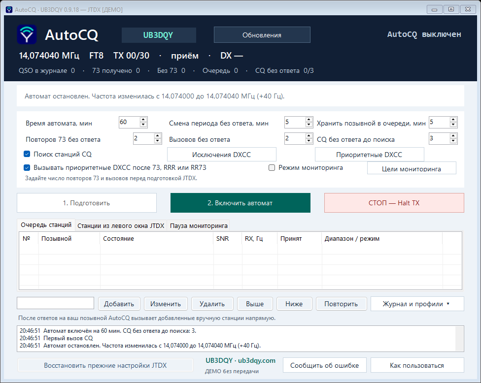

**«Как пользоваться»** opens the Russian offline guide. The English offline guide is **docs/user-guide.en.html**. **«Обновления»** opens Updates.

## 4. Main settings

| Russian label | Meaning |
| --- | --- |
| Время автомата, мин | Session duration in minutes. An active contact is finished before stopping. |
| Повторов 73 без ответа | How many times to repeat the sign-off if the other station stops replying. |
| Вызовов без ответа | Call attempts allowed without a reply. |
| CQ без ответа до поиска | Unanswered CQs before searching the left pane, when search is enabled. |
| Смена периода без ответа, мин | Time without CQ replies before trying the other TX period. |
| Хранить позывной в очереди, мин | Time before stale queue entries expire. |

**«Поиск станций CQ»** enables searching received CQs after the selected threshold. After an unsuccessful call, AutoCQ returns to CQ: CQ → station → CQ.

Set the call limit and sign-off retries before clicking Prepare, with JTDX closed.

### When the other station repeats its report

Say you send RR73 and the other station sends its report again. AutoCQ sends another RR73. Each new report resets the retry counter. With the setting at 2, the first quiet receive period is followed by up to two extra retries, with a chance to reply after each.

A final 73, RR73 or RRR completes the exchange and the session continues. If another report arrives after the last retry, AutoCQ sends another sign-off and starts counting again.

When a repeat is due, AutoCQ keeps the sign-off for the current station even if JTDX has selected a signal report again.

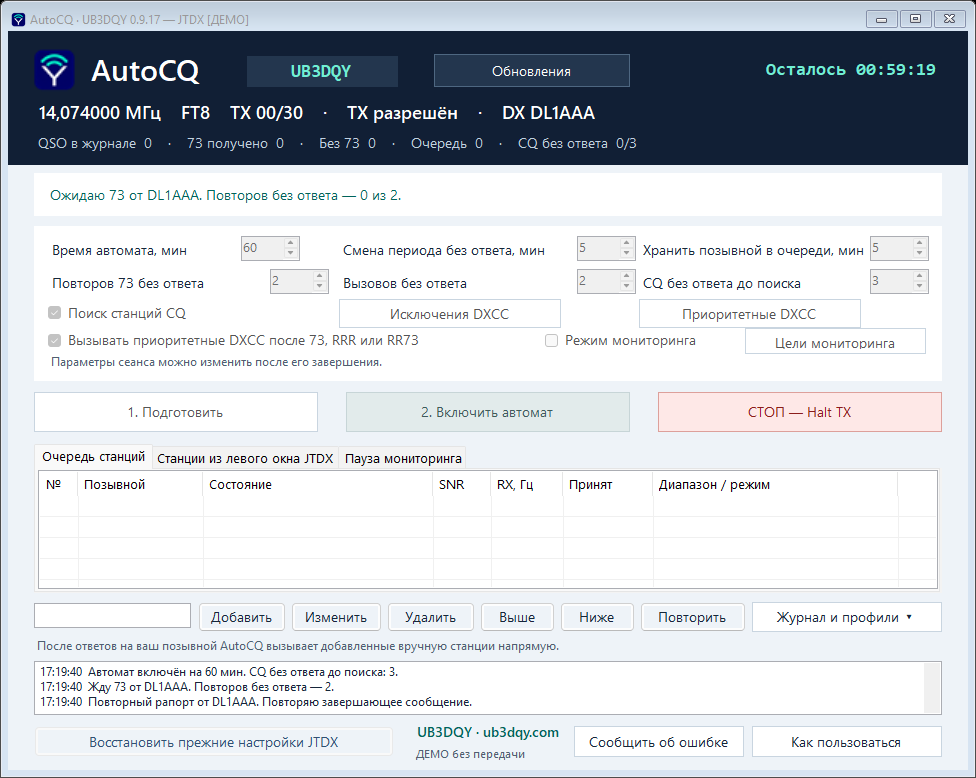

## 5. The station queue

Incoming callers are queued automatically. Among stations calling in the same period, those not yet worked on the current band and mode come first. DXCC priorities and queue order then apply.

If a station just selected for calling does not reply, but another station calls you in that receive period, AutoCQ answers the caller. An established report exchange is not interrupted.

To add a station yourself, enter its callsign below **«Очередь станций»** (Station queue) and click **«Добавить»** (Add). After the current contact and available incoming callers, AutoCQ calls it directly. It does not wait for a CQ or a new decode from that station. This direct call uses JTDX's current TX period and audio frequency.

**«Выше»** and **«Ниже»** move an entry up or down. **«Изменить»** edits the callsign; **«Удалить»** removes it. **«Нет ответа»** means the attempt limit was reached. Select it and click **«Повторить»** to retry. Completing a QSO removes its old queue entry even if logging is delayed.

In **«Станции из левого окна JTDX»** (Stations from the JTDX left pane), select a recent message and click **«Позвать выбранную»** (Call selected). This is the set of messages available to AutoCQ, rather than a complete band log.

## 6. DXCC priorities and exclusions

**«Приоритетные DXCC»** selects preferred entities. Before its own CQ, AutoCQ can call an eligible priority station from the left pane. **«Вызывать приоритетные DXCC после 73, RRR или RR73»** also allows selecting a station after one of those messages.

The **sender** is selected. In “AA1AA JA1BBB 73”, JA1BBB sent the sign-off and becomes the candidate. The message must be fresh and available through JTDX's display filter.

**«Исключения DXCC»** selects entities to skip. Exclusions apply to priorities, the manual queue and monitoring. Check this list if an otherwise matching station is not called.

## 7. Monitoring wanted stations

Open **«Цели мониторинга»** (Monitoring targets). Select DXCC entities, exact callsigns or patterns. Matching any one selected target is enough.

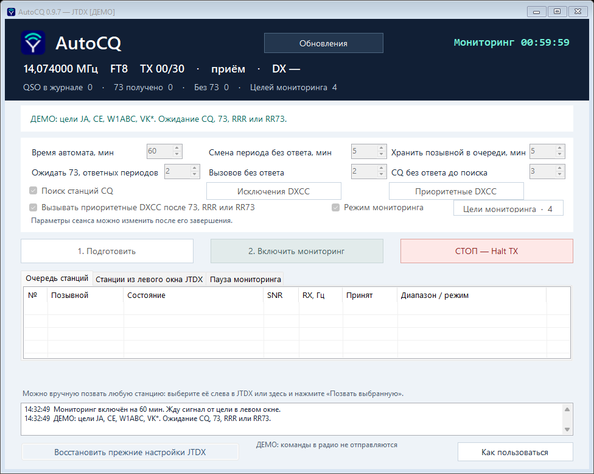

Separate callsigns with spaces, commas or new lines. In patterns, ***** matches any number of characters and **?** matches one: `9J*` matches calls beginning with 9J; `K?ABC` matches K1ABC or K2ABC.

Save the targets, enable **«Режим мониторинга»**, then click **«2. Включить мониторинг»**. AutoCQ listens for recent CQ, 73, RRR and RR73 from matching stations. A sign-off selects its sender. After the QSO or attempt limit, the program returns to receive. It does not call CQ in this mode.

If the other station sends 73, RRR or RR73 before reports are exchanged, the call limit still applies. AutoCQ resumes monitoring once the attempts are used up.

### When a station calls you

AutoCQ answers stations calling you when running CQ, monitoring or searching for award contacts. A station on your DXCC exclusion list is marked as excluded in the queue. Other callers get a reply ahead of the next CQ or outgoing call.


If you are busy, callers wait in the queue until your current QSO finishes. Say you send 73 and someone calls you in the following receive slot. AutoCQ answers that station first, even if it hears an award target in the same slot. If the station you have called has yet to answer, AutoCQ can switch to an incoming caller once the receive slot is complete.

When several stations call in the same slot, AutoCQ gives priority to stations you still need on that band and mode. It also uses your DXCC priorities and queue order. A fresh call from a station you have worked can enter the AutoCQ queue with JTDX's «Отв. B4» (Answer B4) enabled or disabled.

The one-contact-per-target limit and five-minute pause after an unsuccessful search apply to selecting targets yourself. They do not prevent answering an incoming caller. After the QSO or attempt limit, AutoCQ checks other callers and resumes monitoring with the same targets and time remaining. It does not call CQ in this mode.

At the session deadline, AutoCQ finishes the current QSO and handles available incoming calls received before time ran out. New targets and new calls after expiry do not extend the session. Entries marked «Нет ответа» (No answer) are skipped.

If a station sends an acknowledged report late, AutoCQ can resume the exchange after the current contact. For five minutes, JTDX keeps the time of the first report in that attempt and the last report sent to that station. It uses those details when logging the contact automatically.

### Calling another station manually

While monitoring is listening, you can double-click an interesting station's message in JTDX's left pane, even if that station is outside your targets. AutoCQ accepts your choice and follows the contact. Keep JTDX's AutoTX and AutoSelect enabled.

You can also open **«Станции из левого окна JTDX»** in AutoCQ, select a row and click **«Позвать выбранную»** (Call selected). Recent CQ, 73, RRR or RR73 messages are supported. If a contact is already in progress, the button saves your selection until it ends. The selected message must still be available when the call starts.

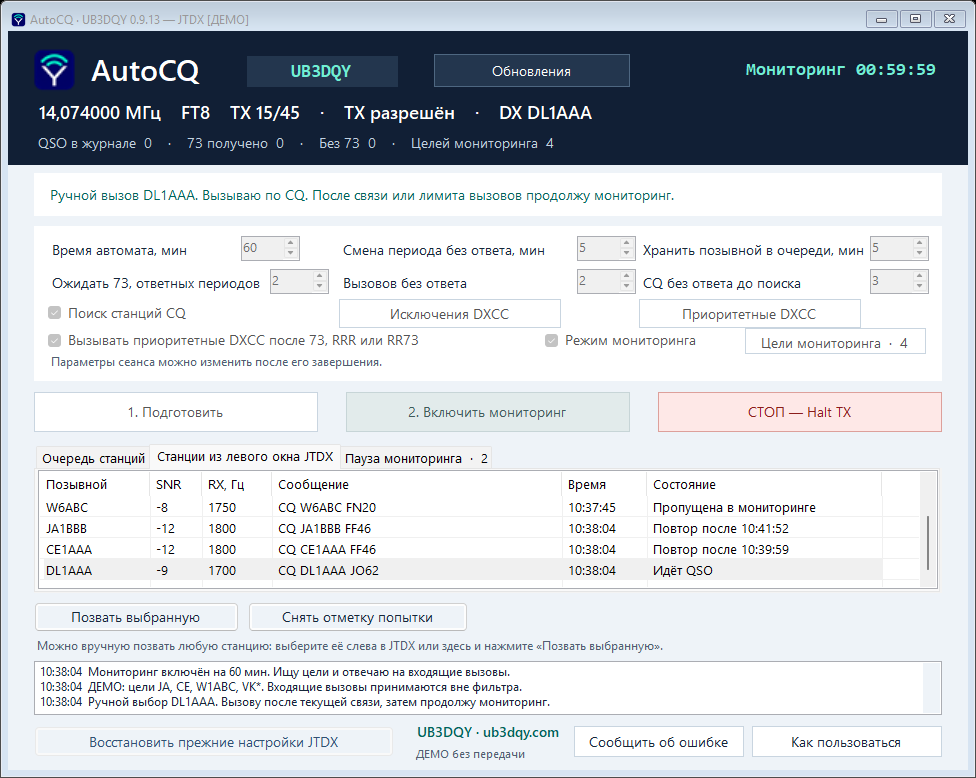

After the QSO or the configured number of unanswered calls, AutoCQ returns to receive and resumes your original targets. Monitoring stays enabled, and its settings and time remaining are preserved. The activity log identifies the manual selection.

This permits one contact attempt even for a non-target station, an already completed target or a station in a retry pause. DXCC exclusions still apply. Once the session timer expires, the module will not start new manual calls; the current contact finishes as usual.

### One contact per target per band

**«Одна связь на цель на диапазоне»** applies to the **target**, rather than to every individual station. With Japan selected, any completed Japanese contact on 20 m completes the Japan target on 20 m. Other Japanese stations on that band are then skipped; Japan on 40 m can still be available.

An exact callsign target is checked for that callsign. A pattern target is completed by a matching contact. AutoCQ uses the main logbook, including earlier sessions and contacts made in other programs. Clear the checkbox to work several stations from the same entity on the same band.

### Stations that did not answer

**«Пауза мониторинга»** (Monitoring retry pause) lists stations that AutoCQ is waiting to call again. This includes calls JTDX ends because the frequency is occupied or the other station answers someone else. Monitoring continues with the same end time. Each row shows the time remaining and the local time when the pause ends.

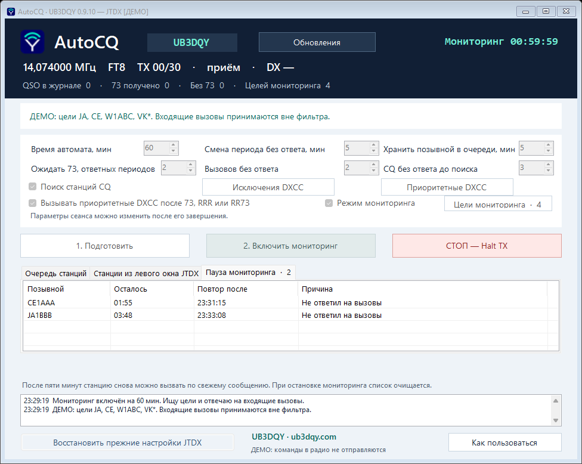

The pause lasts five minutes after the unsuccessful attempt. When it expires, the row disappears and a new fresh message can make that station eligible again. Expiry alone does not start a transmission. Use «Снять отметку попытки» in the left-pane tab to retry sooner.

Stopping monitoring, including a timer stop, clears this list and its pauses. Clearing the monitoring-mode checkbox also resets them. Other entries and completed contacts are preserved.

## Main logbook and profiles

**«Журнал и дипломы»** (Logbook and awards) sits next to the station list. Open **«Основной журнал»** (Main logbook) to see which history AutoCQ uses. When AutoCQ can identify the open LogHX logbook, it offers that file automatically. If the source is JTDX and the complete history lives elsewhere, click **«Выбрать файл»** (Choose file) and select your LogHX logbook (.lhx2) or an ADIF export (.adi, .adif). AutoCQ reads a copy of the LogHX database while the logger stays open.

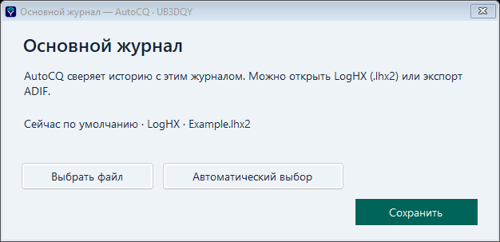

Open **«Подбор целей DXCC»** (Find DXCC targets) and select a band. AutoCQ shows entities with no contact on that band in the selected logbook. It includes contacts in every mode. Tick the entities you want and click **«Добавить в цели»** (Add to targets). You can see the full list in the monitoring settings.

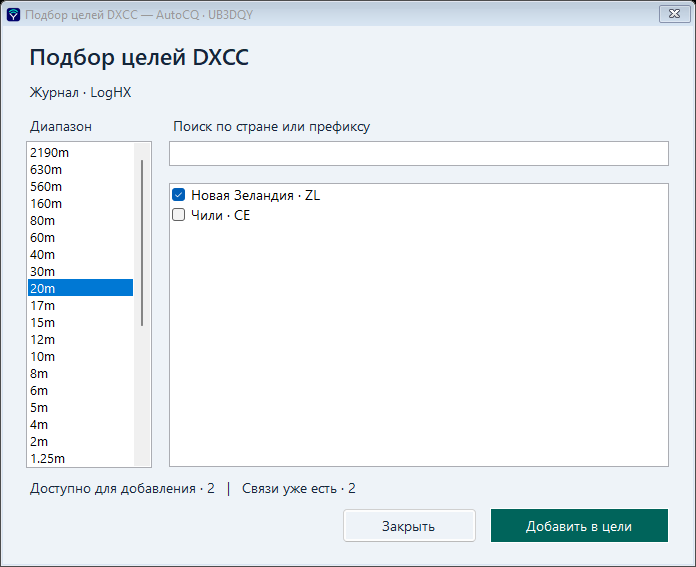

In **«Профили настроек»** (Settings profiles), enter a name such as “40 m in the evening” and click **«Сохранить текущие»** (Save current settings). To use those settings again, stop automation, select the profile and click **«Применить»** (Apply). If the profile changes the sign-off retries or unanswered-call limit, close JTDX, click **«1. Подготовить»** (Prepare) again and restart JTDX as usual.

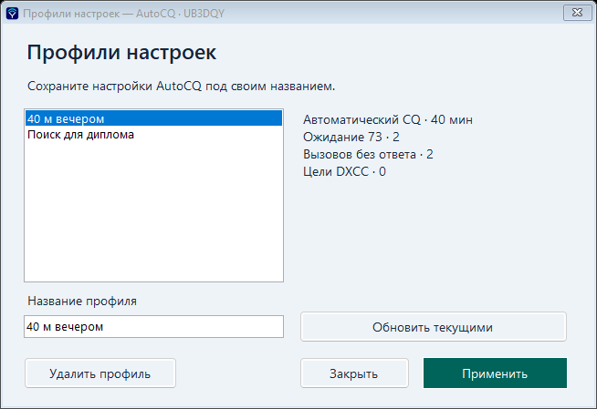

Select a callsign in **«Станции из левого окна JTDX»** and click **«Почему пропущена?»** (Why was this station skipped?). You can see when a retry pause ends, whether a DXCC exclusion applies, whether the target was completed or whether a fresh message is needed.

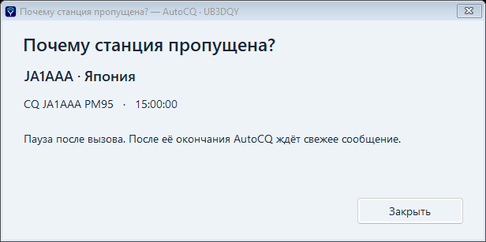

**«Итоги сеанса»** (Session results) shows JTDX log entries, final confirmations and the reason for stopping. AutoCQ checks the main logbook by callsign, band, mode and time. With an ADIF export, refresh the export file before checking recent contacts.

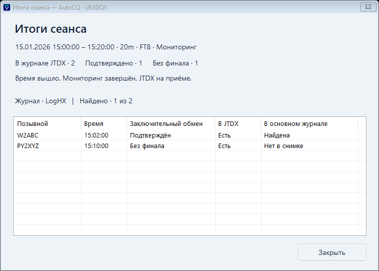

### Search for HAMLOG award contacts

1. Open **«Журнал и дипломы → Дипломы HAMLOG»** (Logbook and awards → HAMLOG awards) and click **«Обновить каталог»** (Update catalog). AutoCQ downloads the award list, then the published conditions. You can select awards as their search rules become ready. After updating AutoCQ, use **«Разобрать скачанное»** (Process downloaded rules) to process documents already on your computer.
2. Click **«Полученные из кабинета…»** (Received awards from my account) to exclude awards you've already received. Sign in to HAMLOG in your browser, open **My received awards**, and use **Ctrl+S** to save the page as **Webpage, HTML only**. If the list spans several pages, save each one and select all the files in AutoCQ. The **«Полученные»** (Received) filter shows the awards you imported. Their checkboxes are disabled. [My awards on HAMLOG](https://hamlog.online/account/awards.php)
3. Select **«Состояние → Доступны для поиска»** (Status → Available for search), tick the awards you want and close the window. While JTDX is receiving, choose **«Журнал и дипломы → Мониторинг дипломов»** (Logbook and awards → Award monitoring). AutoCQ listens on the current band and calls stations that fit.

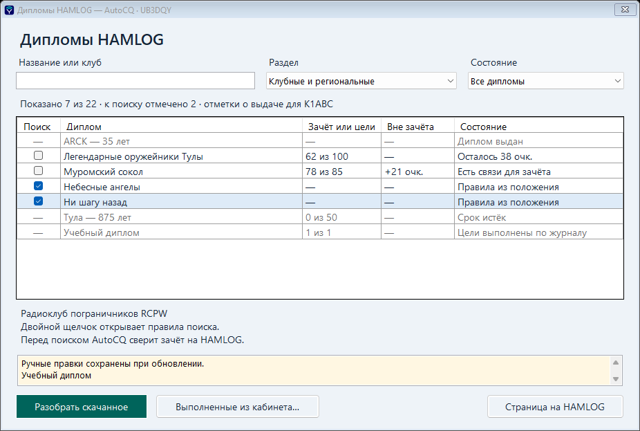

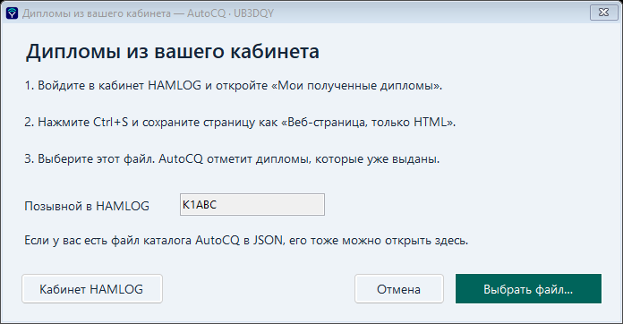

The search depends on the award. A nationwide RDA award looks for stations in European Russia, Asiatic Russia and Kaliningrad. A regional award looks for callsigns from that region. For **Digital QSO Long Distance**, AutoCQ compares your JTDX grid locator with the station's locator from a recent decode. Incoming callers can still get a reply, subject to your DXCC exclusions.

Upload your contacts to your HAMLOG account. There you can see which contacts counted, how many points you have and which awards you can receive. After HAMLOG issues new awards, import **My received awards** again.

Double-click an award to open **«Правила поиска»** (Search rules). Here you can see and edit the criteria. Click **«Сохранить»** (Save) to keep your changes or **«Вернуть исходные»** (Restore original rules) to restore the published settings. AutoCQ keeps your changes when the catalog is updated and lists the awards with saved edits.

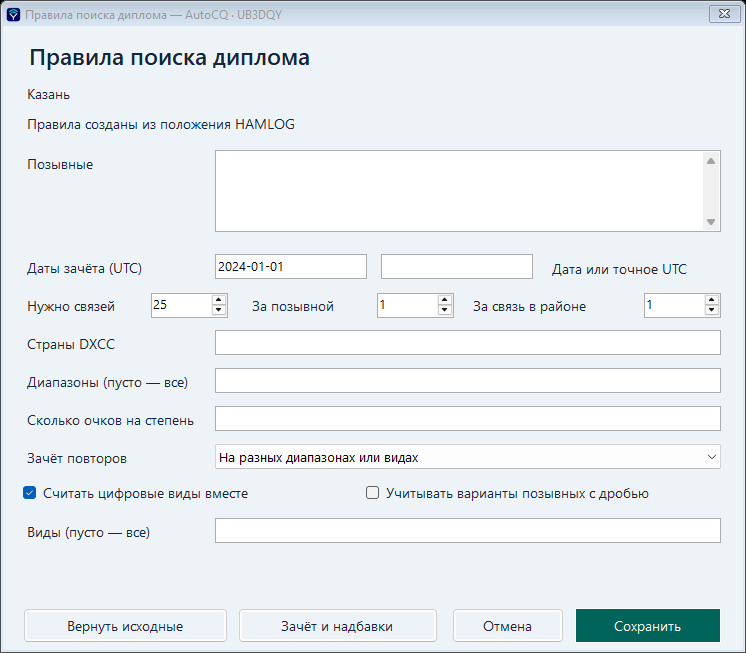

If you cannot select an award, click its name to see why. The award may have ended, its conditions may be unavailable, or AutoCQ may not yet have search rules for it. Choose **«Положение HAMLOG…»** (Published conditions) in the row menu to read the original. Use **«Задать свой список целей…»** (Set your own targets) to enter known callsigns, DXCC entities or patterns.

If the download stops, click **«Продолжить загрузку»** (Resume download). AutoCQ will reuse its saved documents and fetch the ones it still needs. The AutoCQ log shows the reason for the interruption.

## 8. Updates

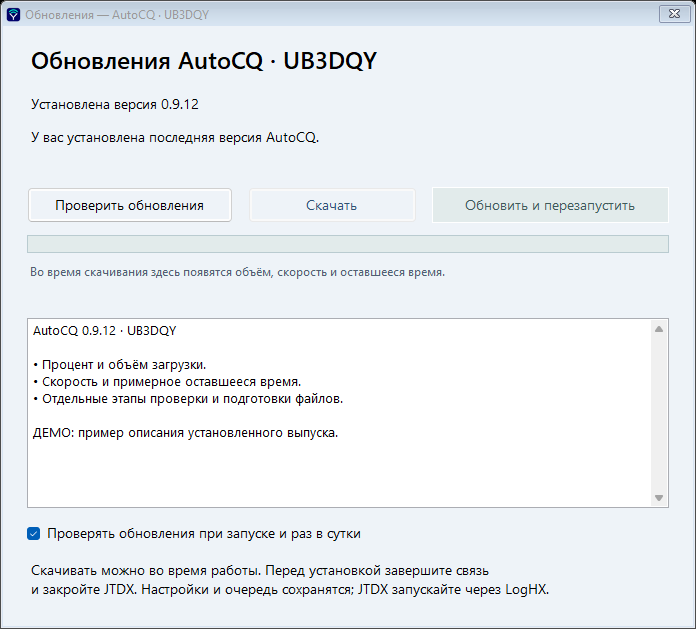

At startup and daily while open, AutoCQ checks GitHub for releases. A newer version highlights Updates and shows a notification. You can disable automatic checks in the window. Requests use public project files; no callsign, settings or log data are uploaded.

Click **«Проверить обновления»** (Check), then **«Скачать»** (Download). Both can run during radio operation. To install, finish the contact and close JTDX. Click **«Обновить и перезапустить»** (Update and restart). AutoCQ checks the archive, updates its files and the JTDX integration when needed, then reopens. Approve Windows permission if requested. LogHX can stay open. After preparation, launch JTDX from LogHX.

Settings and queue entries are preserved. If replacement fails, the installer attempts to restore previous files and keeps a backup beside the downloaded update.

Versions before 0.9.6 have no Updates button. For this first upgrade, close JTDX and AutoCQ and extract the new ZIP over the old folder, replacing files. Open the new application. Future releases can be installed from Updates.

### Following download progress

After clicking Download, the window first shows preparation and connection status. Once the file starts arriving, the bar fills and the window shows the percentage, received and total size, speed, estimated time remaining and elapsed time.

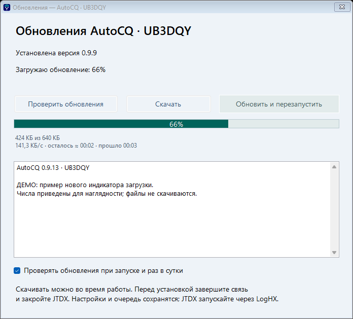

The estimate uses the current average speed and can change. If data stops arriving, the window reports that it is waiting for the server. When the total size is unknown, it shows received bytes and elapsed time without inventing a percentage.

100% means the entire file has arrived. AutoCQ then separately verifies the archive and prepares the update files. Installation becomes available only after validation succeeds. A broken connection or validation failure leaves installation disabled; you can retry downloading.

## 9. Common questions

**No frequency appears, or automation cannot start.** Close JTDX, click Prepare and restart the same JTDX through LogHX. Wait up to 15 seconds. If the build is rejected, check that it is 32A-rc10 Win64.

**A wanted station is visible but is not called.** Check the DXCC, callsign or pattern, exclusions and “One contact per target per band”. Monitoring accepts CQ, 73, RRR and RR73. Unanswered calls start a five-minute pause for that station. To retry earlier, select it in the left-pane tab and click «Снять отметку попытки» (Clear attempt). A new target waits while another QSO is active.

**Time has expired but settings are still disabled.** “Finishing QSO / queue” means the session has not ended yet. Use Halt TX for immediate stopping.

**AutoCQ is off but shows JTDX transmitting.** Check JTDX's own AutoTX and AutoSelect; AutoCQ also displays native or manual activity. Use JTDX's Halt Tx to stop immediately.

**GitHub cannot be reached.** Update checks do not control radio operation. Try later or download the release manually.

To use JTDX without AutoCQ, close JTDX and click **«Восстановить прежние настройки JTDX»**. This restores connection settings and counters; the executable integration remains. Advanced removal is described below.

## 10. Author and feedback

AutoCQ is developed by amateur radio operator **UB3DQY**. Click **UB3DQY** at the top of the main window to open **«О программе»** (About) for version information and project links. You can also open it from the AutoCQ tray icon's menu beside the Windows clock.

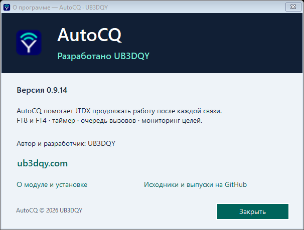

The **«UB3DQY · ub3dqy.com»** link at the bottom of the main window opens the [author's website](https://ub3dqy.com/). About also links to the [project description](https://ub3dqy.com/ru/read/5/) and source code on GitHub.

### Sending a bug report

1. Click **«Сообщить об ошибке»** (Report a bug) at the bottom of the main window as soon as you notice the problem. AutoCQ freezes the preceding 20 minutes. You can do this while it is working.
2. Give the report a short title and explain what happened and what you expected. **«Посмотреть диагностику»** (Preview diagnostics) shows the AutoCQ and JTDX events, program versions and queue state. Events may include callsigns, times and frequencies.

Choose one of the buttons at the bottom of the window.

- **«Отправить в поддержку»** (Send to support). Your description and diagnostics go to the private staff area at ub3dqy.com. No sign-up is required. Wait for the report number. You can copy it from the window.
- **«Отправить и открыть GitHub»** (Send and open GitHub). The diagnostics go to the same private area, and your browser opens an issue draft with your description and report number. Sign in to GitHub to review and publish it.

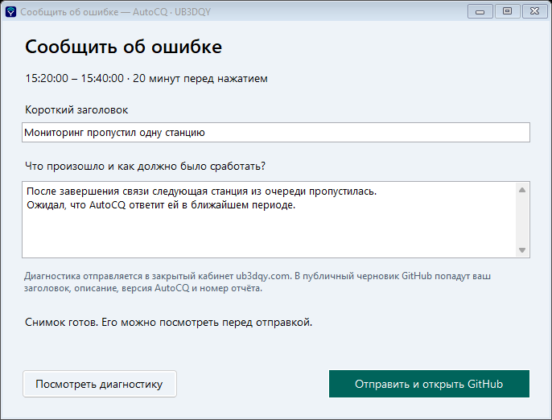

If the site connection drops, retry in the same window to use the original snapshot. For a long GitHub description, AutoCQ copies the text and report number for you to paste into the draft with **Ctrl+V**.

[Create an issue manually or suggest a feature](https://github.com/ub3dqy/jtdx-autocq/issues/new/choose) · [Questions and discussions](https://github.com/ub3dqy/jtdx-autocq/discussions) · [Project article](https://ub3dqy.com/ru/read/5/)

## Advanced: restore the original JTDX executable

With JTDX closed, run from the AutoCQ folder:

```powershell
.\JTDX-AutoCQ-Patch.exe --jtdx "C:\JTDX64\160-32A-rc10\bin\jtdx.exe" --restore
```

Use your own installed path. The tool verifies `jtdx.exe.autocq-original` before restoring the original. Ordinary preparation and updates do not require this command.
