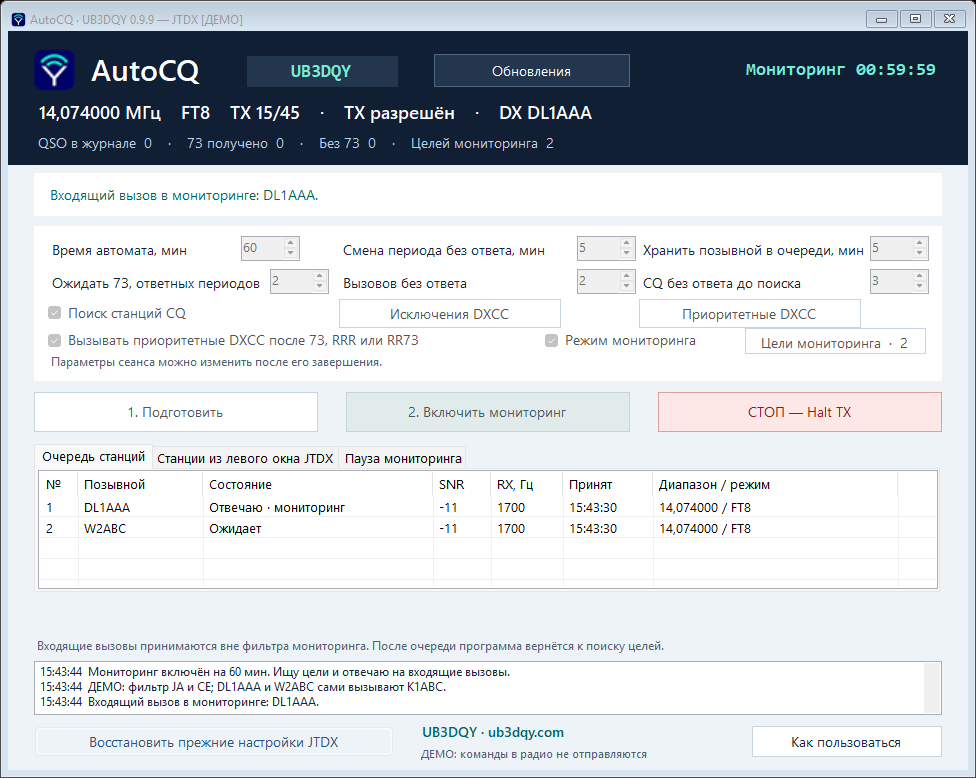

# Using AutoCQ

Guide for AutoCQ 0.9.9 · Author: **UB3DQY** · [Русский](USER-GUIDE.md) · [Project overview](README.en.md)

AutoCQ lets JTDX continue after each contact. It remembers callers while you are busy, then answers the next station or calls CQ again. You choose the session length and selection rules.

Monitoring works differently: JTDX listens until a wanted country or callsign appears, calls that station, then returns to receive. The application interface is currently in Russian; this guide includes the labels you will see.

## 1. Downloads

Get [JTDX 2.2.160-32A-rc10, 64-bit](https://ub3dqy.com/downloads/jtdx/2.2.160-rc10/jtdx-2.2.160-32A-rc10-win64.exe.zip) and the [latest AutoCQ release](https://github.com/ub3dqy/jtdx-autocq/releases/latest).

On GitHub, expand **Assets** and download **JTDX-AutoCQ-…-win64.zip**. The “Source code” archives are for developers. Install JTDX, configure your callsign, audio and radio, check normal operation and close it.

Right-click the AutoCQ ZIP in File Explorer and choose **Extract All**. A separate AutoCQ folder under Documents is convenient. Keep the extracted files together.

## 2. Prepare and start

Open **JTDX-AutoCQ.exe** with JTDX closed. For a first check, choose 5 minutes, 2 call attempts and 2 receive periods for the sign-off. Click **«1. Подготовить»** (Prepare).

If the JTDX integration is missing, this window opens:


Check the path to the installed **jtdx.exe**. Use **«Выбрать файл»** (Choose file) if needed; it is usually in the JTDX **bin** folder. The supported build is **2.2.160-32A-rc10, 64-bit**. Click **«Подготовить JTDX»** (Prepare JTDX), wait for success, then click **«Продолжить»** (Continue). Approve Windows permission if requested.

The original executable is saved beside jtdx.exe. Your callsign, radio, audio, log and window preferences are preserved. This installation step is skipped on future preparations while the integration is current.

Start JTDX. **When using LogHX, launch it from the JTDX icon inside LogHX.** Select a band and FT8 or FT4. The frequency should appear in AutoCQ within a few seconds, occasionally up to 15 seconds.

Keep JTDX **AutoTX** and its native **AutoSelect** enabled. Leave **Single QSO** disabled. Choose your usual filter and left-pane clearing preferences; AutoCQ does not require “Bypass filters” or a permanently full display.

To begin with CQ, clear the JTDX DX callsign and click **«2. Включить автомат»** (Enable automatic operation).

## 3. The main window


The header shows the connection, frequency, mode, selected station and remaining time. Below it are the current state, settings, start/stop buttons, station queue, received-station list and action log.

**«СТОП — Halt TX»** stops automation and sends an immediate Halt TX command to JTDX. Use the timer for a planned end.

When time runs out, **«Завершаю QSO / очередь»** means the session is still finishing. AutoCQ completes the current exchange and handles available queued callers. Entries marked **«Нет ответа»** (No answer) do not keep the session running. Controls become available once it finishes.

**«Как пользоваться»** opens the Russian offline guide. The English offline guide is **docs/user-guide.en.html**. **«Обновления»** opens Updates.

## 4. Main settings

| Russian label | Meaning |
| --- | --- |
| Время автомата, мин | Session duration in minutes. An active contact is finished before stopping. |
| Ожидать 73, ответных периодов | Receive opportunities allowed for a final confirmation. In FT8, the same station can reply every 30 seconds. |
| Вызовов без ответа | Call attempts allowed without a reply. |
| CQ без ответа до поиска | Unanswered CQs before searching the left pane, when search is enabled. |
| Смена периода без ответа, мин | Time without CQ replies before trying the other TX period. |
| Хранить позывной в очереди, мин | Time before stale queue entries expire. |

**«Поиск станций CQ»** enables searching received CQs after the selected threshold. After an unsuccessful call, AutoCQ returns to CQ: CQ → station → CQ.

Change the call and sign-off limits before Prepare, with JTDX closed, because its counters must match. The hint below the settings explains when changes apply.

## 5. The station queue

Incoming callers are queued automatically. Among stations calling in the same period, those not yet worked on the current band and mode come first. DXCC priorities and queue order then apply.

If a station just selected for calling does not reply, but another station calls you in that receive period, AutoCQ answers the caller. An established report exchange is not interrupted.

To add a station yourself, enter its callsign below **«Очередь станций»** (Station queue) and click **«Добавить»** (Add). After the current contact and available incoming callers, AutoCQ calls it directly. It does not wait for a CQ or a new decode from that station. This direct call uses JTDX's current TX period and audio frequency.

**«Выше»** and **«Ниже»** move an entry up or down. **«Изменить»** edits the callsign; **«Удалить»** removes it. **«Нет ответа»** means the attempt limit was reached. Select it and click **«Повторить»** to retry. Completing a QSO removes its old queue entry even if logging is delayed.

In **«Станции из левого окна JTDX»** (Stations from the JTDX left pane), select a recent message and click **«Позвать выбранную»** (Call selected). This is the set of messages available to AutoCQ, rather than a complete band log.

## 6. DXCC priorities and exclusions

**«Приоритетные DXCC»** selects preferred entities. Before its own CQ, AutoCQ can call an eligible priority station from the left pane. **«Вызывать приоритетные DXCC после 73, RRR или RR73»** also allows selecting a station after one of those messages.

The **sender** is selected. In “AA1AA JA1BBB 73”, JA1BBB sent the sign-off and becomes the candidate. The message must be fresh and available through JTDX's display filter.

**«Исключения DXCC»** selects entities to skip. Exclusions apply to priorities, the manual queue and monitoring. Check this list if an otherwise matching station is not called.

## 7. Monitoring wanted stations

Open **«Цели мониторинга»** (Monitoring targets). Select DXCC entities, exact callsigns or patterns. Matching any one selected target is enough.


Separate callsigns with spaces, commas or new lines. In patterns, ***** matches any number of characters and **?** matches one: `9J*` matches calls beginning with 9J; `K?ABC` matches K1ABC or K2ABC.

Save the targets, enable **«Режим мониторинга»**, then click **«2. Включить мониторинг»**. AutoCQ listens for recent CQ, 73, RRR and RR73 from matching stations. A sign-off selects its sender. After the QSO or attempt limit, the program returns to receive. It does not call CQ in this mode.

### When a station calls you

Monitoring targets determine whom AutoCQ searches for and calls itself. A station addressing your callsign is answered even if its country, callsign or pattern is outside those targets. Incoming callers take priority over searching for a new target and over a saved selection made with the Call selected button.



Callers received while you are busy stay in the queue until the current QSO finishes. A final 73 and a new call can arrive in the same period: AutoCQ keeps both messages and answers the next station. If the station you selected has not answered and someone else calls you, AutoCQ switches after the receive period finishes. It does not interrupt an active transmission or a QSO with a responding station.

A station not yet worked on this band and mode comes first. DXCC priorities and queue order apply within the remaining groups. DXCC exclusions remain in force. JTDX's «Отв. B4» (Answer B4) setting controls fresh repeat calls from stations already worked during the session.

The one-contact-per-target limit and five-minute pause after an unsuccessful search apply to selecting targets yourself. They do not prevent answering an incoming caller. After the QSO or attempt limit, AutoCQ checks other callers and resumes monitoring with the same targets and time remaining. It does not call CQ in this mode.

At the session deadline, AutoCQ finishes the current QSO and handles available incoming calls received before time ran out. New targets and new calls after expiry do not extend the session. Entries marked «Нет ответа» (No answer) are skipped.

### Calling another station manually

While monitoring is listening, you can double-click an interesting station's message in JTDX's left pane, even if that station is outside your targets. AutoCQ accepts your choice and follows the contact. Keep JTDX's AutoTX and AutoSelect enabled.

You can also open **«Станции из левого окна JTDX»** in AutoCQ, select a row and click **«Позвать выбранную»** (Call selected). Recent CQ, 73, RRR or RR73 messages are supported. If a contact is already in progress, the button saves your selection until it ends. The selected message must still be available when the call starts.


After the QSO or the configured number of unanswered calls, AutoCQ returns to receive and resumes your original targets. Monitoring stays enabled, and its settings and time remaining are preserved. The activity log identifies the manual selection.

This permits one contact attempt even for a non-target station, an already completed target or a station in a retry pause. DXCC exclusions still apply. Once the session timer expires, the module will not start new manual calls; the current contact finishes as usual.

### One contact per target per band

**«Одна связь на цель на диапазоне»** applies to the **target**, rather than to every individual station. With Japan selected, any completed Japanese contact on 20 m completes the Japan target on 20 m. Other Japanese stations on that band are then skipped; Japan on 40 m can still be available.

An exact callsign target is checked for that callsign. A pattern target is completed by a matching contact. The JTDX log, including earlier sessions, is considered. Clear the checkbox to work several stations from the same entity on the same band.

### Stations that did not answer

**«Пауза мониторинга»** (Monitoring retry pause) lists stations that did not answer within the call limit. Each row shows minutes and seconds remaining and the local time when the pause ends. It refreshes every second. An active exchange is not listed as unanswered.


The pause lasts five minutes after the unsuccessful attempt. When it expires, the row disappears and a new fresh message can make that station eligible again. Expiry alone does not start a transmission. Use «Снять отметку попытки» in the left-pane tab to retry sooner.

Stopping monitoring, including a timer stop, clears this list and its pauses. Clearing the monitoring-mode checkbox also resets them. Other entries and completed contacts are preserved.

## 8. Updates


At startup and daily while open, AutoCQ checks GitHub for releases. A newer version highlights Updates and shows a notification. You can disable automatic checks in the window. Requests use public project files; no callsign, settings or log data are uploaded.

Click **«Проверить обновления»** (Check), then **«Скачать»** (Download). Both can run during radio operation. To install, finish the contact and close JTDX. Click **«Обновить и перезапустить»** (Update and restart). AutoCQ closes, checks the archive, replaces its files and reopens. Approve Windows permission if requested. Keep LogHX open; after the update and normal preparation, launch JTDX from LogHX.

Settings and queue entries are preserved. If replacement fails, the installer attempts to restore previous files and keeps a backup beside the downloaded update.

Versions before 0.9.6 have no Updates button. For this first upgrade, close JTDX and AutoCQ and extract the new ZIP over the old folder, replacing files. Open the new application. Future releases can be installed from Updates.

## 9. Common questions

**No frequency appears, or automation cannot start.** Close JTDX, click Prepare and restart the same JTDX through LogHX. Wait up to 15 seconds. If the build is rejected, check that it is 32A-rc10 Win64.

**A wanted station is visible but is not called.** Check the DXCC, callsign or pattern, exclusions and “One contact per target per band”. Monitoring accepts CQ, 73, RRR and RR73. Unanswered calls start a five-minute pause for that station. To retry earlier, select it in the left-pane tab and click «Снять отметку попытки» (Clear attempt). A new target waits while another QSO is active.

**Time has expired but settings are still disabled.** “Finishing QSO / queue” means the session has not ended yet. Use Halt TX for immediate stopping.

**AutoCQ is off but shows JTDX transmitting.** Check JTDX's own AutoTX and AutoSelect; AutoCQ also displays native or manual activity. Use JTDX's Halt Tx to stop immediately.

**GitHub cannot be reached.** Update checks do not control radio operation. Try later or download the release manually.

To use JTDX without AutoCQ, close JTDX and click **«Восстановить прежние настройки JTDX»**. This restores connection settings and counters; the executable integration remains. Advanced removal is described below.

## 10. Author and feedback

AutoCQ is developed by amateur radio operator **UB3DQY**. Click **UB3DQY** at the top of the main window to open **«О программе»** (About) for version information and project links. You can also open it from the AutoCQ tray icon's menu beside the Windows clock.


The **«UB3DQY · ub3dqy.com»** link at the bottom of the main window opens the [author's website](https://ub3dqy.com/). About also links to the [project description](https://ub3dqy.com/ru/read/5/) and source code on GitHub.

[Report a bug or suggest a feature](https://github.com/ub3dqy/jtdx-autocq/issues/new/choose) · [Questions and discussions](https://github.com/ub3dqy/jtdx-autocq/discussions) · [Project article](https://ub3dqy.com/ru/read/5/)

Include both program versions, what you did, what you expected and what happened. The event time is useful for radio issues. Share only the relevant excerpt and remove personal information.

## Advanced: restore the original JTDX executable

With JTDX closed, run from the AutoCQ folder:

```powershell
.\JTDX-AutoCQ-Patch.exe --jtdx "C:\JTDX64\160-32A-rc10\bin\jtdx.exe" --restore
```

Use your own installed path. The tool verifies `jtdx.exe.autocq-original` before restoring the original. Ordinary preparation and updates do not require this command.
