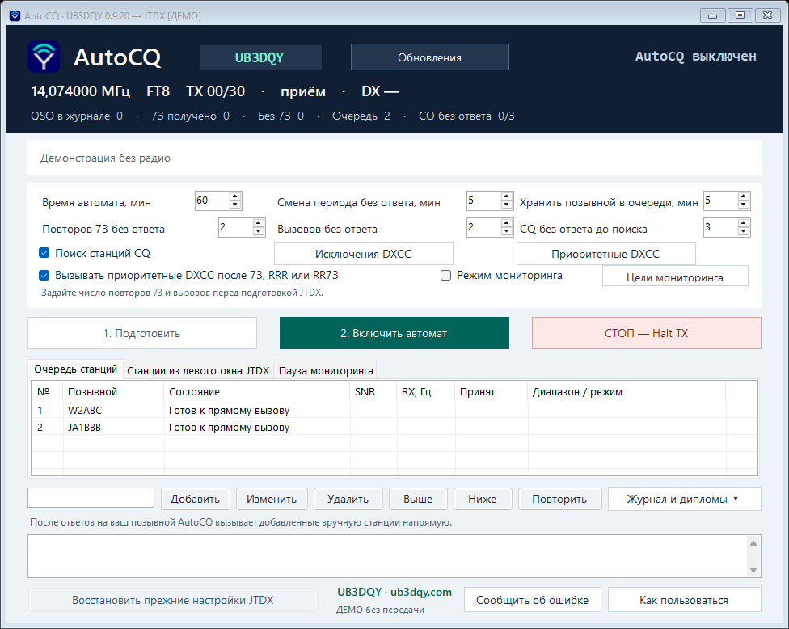
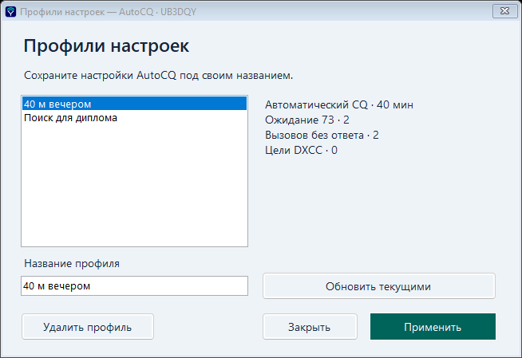
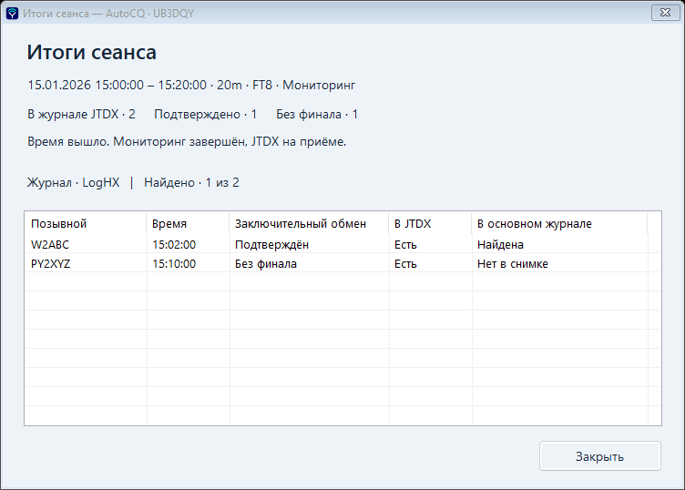
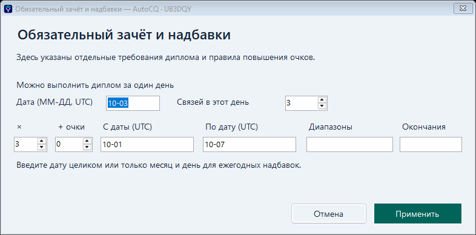
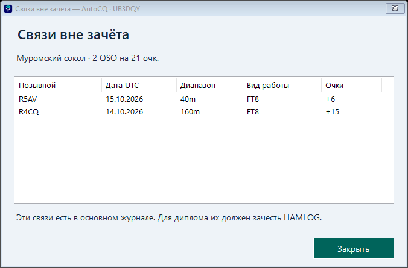
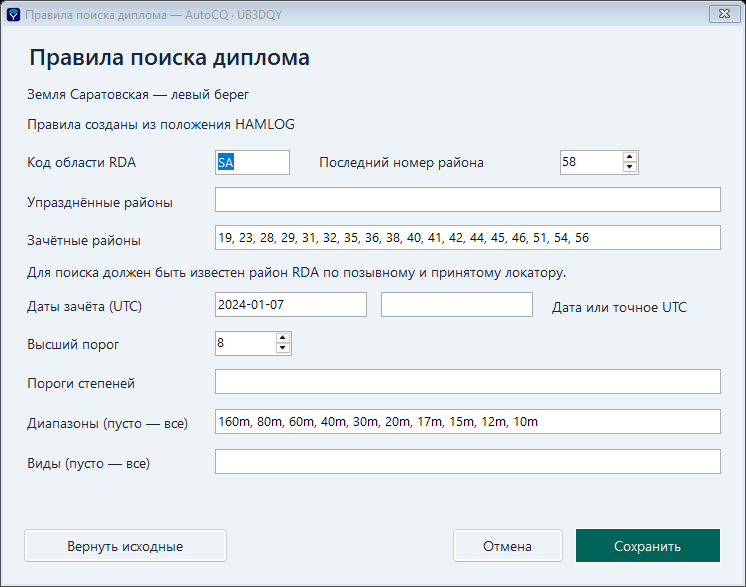
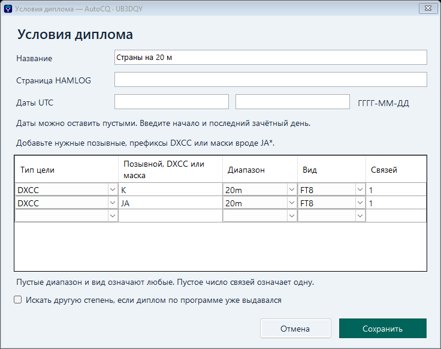

# Как пользоваться AutoCQ

Руководство для AutoCQ 0.9.25 · **UB3DQY** · [English](USER-GUIDE.en.md) · [Главная страница](README.md)

AutoCQ нужен, чтобы JTDX продолжал работать после очередной связи. Пока вы отвечаете одному корреспонденту, модуль запоминает остальных. Закончив QSO, он выбирает следующую станцию или возвращается к общему вызову. Время работы и правила выбора задаёте вы.

В режиме мониторинга программа слушает эфир и сама вызывает станции из выбранных стран или по нужным позывным. Можно выбрать другую станцию вручную, провести с ней связь и вернуться к мониторингу.

## 1. Что скачать

Нужны два архива: [JTDX 2.2.160-32A-rc10, 64 бита](https://ub3dqy.com/downloads/jtdx/2.2.160-rc10/jtdx-2.2.160-32A-rc10-win64.exe.zip) и [последний выпуск AutoCQ](https://github.com/ub3dqy/jtdx-autocq/releases/latest).

На GitHub откройте **Assets** и выберите файл **JTDX-AutoCQ-…-win64.zip**. Архивы «Source code» предназначены для разработчиков. Установите JTDX, проверьте свой позывной, звук, приём и передачу обычным способом, затем закройте JTDX.

Архив AutoCQ распакуйте через «Извлечь всё» в Проводнике. Удобно создать папку AutoCQ в «Документах». Сохраните все файлы архива вместе: рядом с программой находятся инструкция и файлы подготовки.

## 2. Подготовка и запуск

Откройте **JTDX-AutoCQ.exe**, пока JTDX закрыт. Для знакомства подойдут 5 минут, 2 вызова и 2 повтора 73 без ответа. Нажмите **«1. Подготовить»**.

Если дополнение к JTDX ещё не установлено, откроется такое окно:


Проверьте путь к установленному **jtdx.exe**. Если он неверный, нажмите «Выбрать файл» и найдите его в папке JTDX, обычно внутри **bin**. Нужна именно **2.2.160-32A-rc10, 64 бита**. Нажмите «Подготовить JTDX», дождитесь сообщения о готовности и нажмите «Продолжить». При необходимости Windows попросит разрешение изменить установленный файл.

AutoCQ сохраняет оригинальный jtdx.exe рядом с ним. Ваш позывной, звук, трансивер, журнал и настройки окна сохраняются. При следующей подготовке эта процедура уже не понадобится, если дополнение актуально.

Теперь запустите JTDX. **В связке с LogHX используйте значок JTDX в самом LogHX.** Выберите диапазон и FT8 или FT4. Через несколько секунд в AutoCQ появится частота; иногда нужно подождать до 15 секунд.

В JTDX оставьте включёнными **«АвтоTX»** и штатный **«Автовыбор»**, а **«Одиночное QSO»** — выключенным. Фильтр и очистку левого окна настройте так, как вам удобно: модуль не требует режима «Без фильтра» или постоянно заполненного окна.

Чтобы начать с CQ, очистите «Позывной DX» в JTDX и нажмите **«2. Включить автомат»** в AutoCQ.

## 3. Что видно в главном окне



Вверху показаны подключение JTDX, частота, режим, текущая станция и оставшееся время. Под ними — состояние автомата и основные параметры. Ниже находятся кнопки запуска и остановки, очередь станций, список сообщений левого окна и небольшой журнал действий.

**«СТОП — Halt TX»** останавливает автомат и посылает JTDX команду прекратить передачу. Это немедленная остановка. Для планового окончания пользуйтесь таймером.

Когда таймер истечёт, надпись **«Завершаю QSO / очередь»** означает, что модуль ещё работает: он заканчивает текущую связь и обрабатывает доступные вызовы. Станции с пометкой «Нет ответа» не удерживают сеанс. После завершения параметры снова становятся доступны.

Если сеанс остановился из-за изменения частоты, режима или периода TX, AutoCQ покажет, что именно изменилось. При перестройке видны обе частоты и сдвиг в герцах. Причина также сохраняется в журнале и в итогах сеанса.


Кнопка **«Как пользоваться»** открывает эту инструкцию без интернета. Кнопка **«Обновления»** показывает установленную версию и проверяет новые выпуски.

## 4. Основные настройки

| Поле | Что оно меняет |
| --- | --- |
| Время автомата, мин | Через сколько минут начать завершение работы. Текущая связь заканчивается до остановки. |
| Повторов 73 без ответа | Сколько раз повторить завершающее сообщение, если корреспондент перестал отвечать. |
| Вызовов без ответа | Сколько раз вызывать станцию, если ответа от неё нет. |
| CQ без ответа до поиска | После скольких общих вызовов искать станцию в левом окне, если включён поиск. |
| Смена периода без ответа, мин | Когда при длительном отсутствии ответов на CQ попробовать другой период передачи. |
| Хранить позывной в очереди, мин | Когда удалять устаревшие записи очереди. |

**«Поиск станций CQ»** разрешает поиск по левому окну после заданного числа общих вызовов. После неудачного вызова найденной станции модуль возвращается к CQ: общий вызов → станция → общий вызов.

Число вызовов и повторов 73 задавайте перед «Подготовить», пока JTDX закрыт.

### Если корреспондент повторяет рапорт

Допустим, вы отправили RR73, а корреспондент снова передал рапорт. AutoCQ отправит ему RR73 ещё раз. Каждый такой рапорт обнуляет счётчик повторов без ответа. Если в поле стоит 2, после первого приёма без ответа модуль сделает до двух дополнительных повторов и после каждого прослушает ответный период.

Если придёт заключительное 73, RR73 или RRR, модуль завершит обмен и продолжит сеанс. Если после последнего повтора придёт ещё один рапорт, AutoCQ снова ответит ему и начнёт отсчёт заново.


## 5. Очередь: кого вызовет программа

Станции, которые зовут вас, попадают в очередь автоматически. Если несколько станций позвали одновременно, преимущество получают те, с кем ещё не было связи на текущем диапазоне в текущем режиме. Затем учитываются приоритеты DXCC и порядок очереди.

Если станция, которую модуль только начал звать, не ответила, а другая позвала вас в этом приёмном периоде, AutoCQ отвечает вызывающей. Начавшийся обмен рапортами не прерывается ради другой станции.

Для ручного добавления введите позывной под вкладкой **«Очередь станций»** и нажмите **«Добавить»**. После текущего QSO и доступных вызывающих модуль позовёт его напрямую, без ожидания CQ или другого сообщения от этой станции. Такой вызов использует текущие период и звуковую частоту TX JTDX.

Кнопки **«Выше»** и **«Ниже»** меняют порядок, **«Изменить»** исправляет позывной, **«Удалить»** убирает запись. После лимита попыток появляется **«Нет ответа»**. Если хотите попробовать ещё раз, выделите станцию и нажмите **«Повторить»**. Завершённая связь убирает старую запись, даже если запись в журнале задержалась.

Во вкладке **«Станции из левого окна JTDX»** можно выделить свежее сообщение и нажать **«Позвать выбранную»**. Эта вкладка показывает доступные модулю сообщения, а не полный журнал эфира.

## 6. Приоритеты и исключения DXCC

В **«Приоритетных DXCC»** отметьте страны и территории, которым хотите отдавать предпочтение. Перед своим CQ AutoCQ сможет выбрать подходящую приоритетную станцию из левого окна. Галочка **«Вызывать приоритетные DXCC после 73, RRR или RR73»** разрешает выбирать её и после такого сообщения.

По прощанию выбирается **отправитель**. Например, в сообщении «AA1AA JA1BBB 73» прощается JA1BBB — он и будет кандидатом на вызов. Сообщение должно быть свежим и доступным модулю после фильтра JTDX.

В **«Исключениях DXCC»** отметьте страны, которые автомат должен пропускать. Исключение действует также на приоритеты, ручную очередь и мониторинг. Если цель не вызывается, проверьте, не находится ли она в исключениях.

## 7. Мониторинг для дипломов и нужных позывных

Откройте **«Цели мониторинга»**. Можно выбрать страны DXCC, точные позывные и маски. Достаточно совпадения с одной из выбранных целей.


Точные позывные разделяйте пробелами, запятыми или переносами строк. В масках звёздочка означает любое число знаков, а вопросительный знак — один знак: `9J*` подходит позывным с началом 9J, `K?ABC` — K1ABC или K2ABC.

Сохраните цели, включите **«Режим мониторинга»** и нажмите **«2. Включить мониторинг»**. Программа останется на приёме и будет искать свежие CQ, 73, RRR и RR73 от подходящих станций. При выборе по финальному сообщению вызывается его отправитель. После QSO или лимита вызовов AutoCQ снова слушает эфир. Общий вызов в этом режиме не передаётся.

Если корреспондент присылает 73, RRR или RR73 ещё до обмена рапортами, лимит вызовов по-прежнему действует. Когда попытки закончатся, AutoCQ продолжит мониторинг.

### Если станция сама вас зовёт

AutoCQ отвечает на вызовы по вашему позывному при работе с CQ, в обычном мониторинге и в поиске для дипломов. Вызовы из списка исключений DXCC показаны в очереди с отметкой «Исключение DXCC». Остальным вызывающим AutoCQ отвечает раньше следующего CQ или вызова выбранной цели.


Если вы заняты, вызывающие ждут в очереди до завершения текущего QSO. Например, вы передали 73, а в следующем приёмном периоде вас позвала другая станция. AutoCQ сначала ответит ей, даже если в том же периоде появилась цель для диплома. Если выбранная станция ещё не ответила, а другая уже зовёт вас, модуль переключится после полного приёмного периода.

Если одновременно зовут несколько станций, первой идёт та, с которой ещё не было QSO на этом диапазоне и в этом виде работы. При выборе также учитываются приоритеты DXCC и порядок очереди. Свежий повторный вызов AutoCQ принимает при любом положении «Отв. B4» в JTDX.

Галочка «Одна связь на цель на диапазоне» и пятиминутная пауза после неудачного поиска относятся к самостоятельному выбору целей. Ответить станции, которая сама вас зовёт, они не мешают. После QSO или лимита попыток AutoCQ проверит остальных вызывающих и вернётся к мониторингу с прежними целями и оставшимся временем. Общий вызов в этом режиме не передаётся.

Когда время истекло, модуль закончит текущую связь и обработает доступные входящие вызовы, принятые до окончания времени. Новые цели и новые входящие вызовы после этого уже не продлевают сеанс. Станции с отметкой «Нет ответа» пропускаются.

Если корреспондент пришлёт подтверждённый рапорт с задержкой, AutoCQ может продолжить обмен с ним после текущей связи. В течение пяти минут JTDX помнит время первого рапорта этой попытки и последний рапорт, который был передан именно этой станции. Эти данные используются при автоматической записи.

### Как вызвать другую станцию вручную

Если во время приёма вы заметили интересную станцию за пределами своих целей, дважды нажмите на её сообщение в левом окне JTDX. AutoCQ примет ваш выбор и продолжит сопровождать эту связь. «АвтоTX» и «Автовыбор» в JTDX должны оставаться включёнными.

Можно сделать это и из AutoCQ: откройте **«Станции из левого окна JTDX»**, выделите строку и нажмите **«Позвать выбранную»**. Подойдёт свежее CQ, 73, RRR или RR73. Если уже идёт другая связь, кнопка сохранит ваш выбор до её завершения; перед вызовом сообщение выбранной станции должно оставаться доступным.


После QSO или заданного числа вызовов без ответа AutoCQ вернётся на приём и продолжит искать ваши цели. Ничего включать заново не нужно: список целей и оставшееся время сохраняются. В журнале действий будет указано, что станция выбрана вручную.

Такой выбор разрешает одну попытку связи, даже если станция не входит в цели, цель уже выполнена или действует пауза после прежнего вызова. Исключения DXCC остаются в силе. Когда время сеанса истекло, новые ручные вызовы из модуля не запускаются; текущая связь заканчивается обычным образом.

### «Одна связь на цель на диапазоне»

Это ограничение относится к **цели**, а не ко всем станциям по отдельности. Если вы выбрали Японию и уже провели QSO с любой японской станцией на 20 м, цель «Япония на 20 м» выполнена. Другую японскую станцию на 20 м модуль пропустит. На 40 м та же страна может ещё оставаться доступной.

Если цель — точный позывной, проверяется связь с ним. Для маски выполненной считается цель, которой соответствует проведённая связь. Учитывается основной журнал, в том числе связи из предыдущих сеансов и других программ. Чтобы работать с несколькими станциями одной страны на том же диапазоне, снимите галочку.

### Станции, которые не ответили

Во вкладке **«Пауза мониторинга»** видны станции, которым AutoCQ пока не будет повторять вызов. Сюда попадают и вызовы, прерванные JTDX из-за занятой частоты или ответа корреспондента другой станции. В таком случае мониторинг продолжается с прежним временем окончания. Для каждого позывного видны оставшееся время и время окончания паузы.


Пауза длится пять минут после неудачной попытки. Когда она закончится, строка исчезнет, и AutoCQ сможет снова выбрать станцию по новому свежему сообщению. Само истечение времени не запускает передачу. Кнопка «Снять отметку попытки» во вкладке левого окна позволяет попробовать раньше.

При остановке мониторинга, в том числе по таймеру, список и его паузы очищаются. Выключение галочки «Режим мониторинга» также сбрасывает их. Другие записи и проведённые связи сохраняются.

## Рабочий журнал и профили

Кнопка **«Журнал и дипломы»** находится рядом со списком станций. Откройте **«Основной журнал»**, чтобы увидеть, откуда AutoCQ берёт историю. Когда программа однозначно определяет журнал открытого LogHX, она предлагает его автоматически. Если указан JTDX, а общая история хранится в другом месте, нажмите **«Выбрать файл»** и укажите свой журнал LogHX (.lhx2) или экспорт ADIF (.adi, .adif). AutoCQ читает копию базы LogHX, пока сам журнал открыт.


В **«Подборе целей DXCC»** выберите диапазон. AutoCQ покажет страны, с которыми в этой истории ещё нет связи на выбранном диапазоне. Учитываются связи во всех режимах. Отметьте нужные страны и нажмите **«Добавить в цели»**. Полный список можно посмотреть в настройках мониторинга.


В **«Профилях настроек»** введите название, например «40 м вечером», и нажмите **«Сохранить текущие»**. Чтобы вернуться к этим настройкам, остановите автомат, выберите профиль и нажмите **«Применить»**. Если профиль меняет число повторов 73 или вызовов, закройте JTDX, снова нажмите **«1. Подготовить»**, затем запустите JTDX обычным способом.



Во вкладке **«Станции из левого окна JTDX»** выберите позывной и нажмите **«Почему пропущена?»**. Если действует пауза, окно покажет время её окончания. Там же можно увидеть исключение DXCC, выполненную цель или ожидание свежего сообщения.


В **«Итогах сеанса»** видны записи JTDX, состояние финального обмена и причина остановки. AutoCQ ищет каждую связь в основном журнале по позывному, диапазону, режиму и времени. Если используется экспорт ADIF, для сверки свежих связей понадобится обновить файл экспорта.



### Поиск для дипломов HAMLOG

1. Откройте **«Журнал и дипломы → Дипломы HAMLOG»** и нажмите **«Обновить каталог»**. Сначала загрузится список, затем положения. Если после обновления AutoCQ видна кнопка **«Разобрать скачанное»**, нажмите её. AutoCQ сначала обработает положения, которые уже есть на компьютере. Готовые карточки будут появляться в списке по мере разбора.
2. Чтобы скрыть уже выданные вам дипломы, нажмите **«Выполненные из кабинета…»**. Войдите в HAMLOG в браузере, откройте **«Мои полученные дипломы»**, сохраните страницу через **Ctrl+S** в формате **«Веб-страница, только HTML»** и выберите этот файл в AutoCQ. [Открыть страницу дипломов HAMLOG](https://hamlog.online/account/awards.php)
3. Выберите **«Состояние → Доступны для поиска»** и отметьте нужные дипломы в столбце **«Поиск»**. Закройте окно, чтобы сохранить выбор. Пока JTDX на приёме, выберите **«Журнал и дипломы → Мониторинг дипломов»**. AutoCQ сверит зачёт по выбранным дипломам, для которых доступна проверка, и начнёт слушать текущий диапазон.


При временном сбое AutoCQ повторяет запрос. Если загрузка прервалась, нажмите **«Продолжить загрузку»**. Скачанные файлы используются повторно. Если HAMLOG попросил подождать, сообщение подскажет время ожидания, когда его сообщил сайт. Подробности ошибки сохраняются в журнале AutoCQ.

По умолчанию открывается список **«Действующие»**. В фильтре **«Состояние»** можно отдельно посмотреть **«Выполненные и выданные»**, **«Срок истёк»** или **«Все дипломы»**. Прочерк в столбце **«Поиск»** означает, что диплом сейчас нельзя включить в мониторинг. Если срок истечёт во время сеанса, AutoCQ исключит диплом из выбора новых целей. Выбор действующих дипломов сохраняется при смене фильтра, а над таблицей видно число отмеченных карточек.

Перенесите страницу из кабинета ещё раз после получения новых дипломов. Чтобы посмотреть текущий зачёт отдельного диплома, щёлкните по его строке правой кнопкой и выберите **«Сверить зачёт с HAMLOG»**. Выполненный диплом снимается с поиска после сверки или проверки журнала. Для открытой степени многоступенчатой программы поиск можно продолжить.

**«Правила из положения»** означает, что AutoCQ уже подготовил условия поиска. При статусе **«Условия пока не распознаны»** документ скачан, но AutoCQ ещё не может составить по нему правила. Например, для части клубных дипломов нужен отдельный список участников. **«Текст PDF не прочитан»** означает, что файл есть и программа не смогла извлечь из него текст. Оригинал открывается из меню строки через **«Положение HAMLOG…»**.

При статусе **«Проверено · поиск недоступен»** выделите строку. Под таблицей будет пояснение по этой карточке. Например, для RAEM подходят связи телеграфом, а для «Рек России» нужен код объекта на момент QSO.

У каждого подготовленного диплома своё правило повторов. Например, для диплома OE6XMF засчитывается одна связь в сутки UTC, даже если станция меняет диапазон или работает с дробью в позывном. В «Перевале Стельвио» количество очков зависит от страны корреспондента.

Для дипломов по районам RDA, например «Воронежская область», AutoCQ проверяет прогресс до ближайшей открытой степени. Он ищет связь для нового района, когда позывной и локатор совпадают с известной записью. Сведения о районе берутся из основного журнала и зачёта HAMLOG. Если в журнале есть две разные записи о районе для одной пары позывного и локатора, AutoCQ ждёт другой подходящей станции.

Для **«Земли Саратовской — левый берег»** нужны восемь разных районов на КВ. Двойной щелчок по диплому открывает поле **«Зачётные районы»** со списком из положения. Для **«Тулы»** каждый QSO даёт два очка. Если зачтены 18 связей из четырёх районов, итог равен 36 × 4 = 144 очка. Новый район увеличит множитель. [Положение «Земля Саратовская»](https://hamlog.online/global/russia/r4c/1025/rules/) · [Положение «Тула»](https://hamlog.online/global/russia/r3p/485/rules/)

Для **WHCG** AutoCQ берёт первые четыре знака свежего локатора эквадорской станции. Программа проверяет, нужен ли этот квадрат, и показывает ближайшую степень из 5, 12 или 20 квадратов. Для **FIRAC OE DIGI** нужно 30 цифровых связей, среди них связи с тремя разными станциями австрийской группы. Повтор на другом диапазоне может добавить связь к общему зачёту и оставляет число разных станций прежним. [Положение WHCG](https://hamlog.online/club/hcdx/177/rules/) · [Положение FIRAC OE](https://www.oevsv.at/oevsv/diplome/)

У «Казани» два условия. Нужно провести 25 зачтённых связей и сработать с пятью разными районами города. Если в таблице видно **«25 из 25 · 4 из 5»**, AutoCQ будет искать станцию из пятого района. Для «Санкт-Петербургской телебашни» общий порог составляет 60 очков, а отдельно нужна связь с RC1B или с одним из операторов, перечисленных в положении. [Положение «Казань»](https://hamlog.online/club/kazan/be5792cd277125309bc1216c86f36bba/rules/) · [Положение о телебашне](https://hamlog.online/global/russia/r1a/a75954ec9180c819a1a6d4bb4e2fd522/rules/)

Чтобы посмотреть обязательные условия, откройте правила диплома двойным щелчком по строке и нажмите **«Зачёт и надбавки»**. Здесь видны нужные районы, позывные и повышенные ставки за время или диапазон. После правки нажмите **«Применить»**, затем **«Сохранить»** в правилах диплома. При следующей сверке AutoCQ проверит обязательные счётчики, которые предоставляет HAMLOG. Исходные условия можно вернуть кнопкой **«Вернуть исходные»**.



Для «Моей России» AutoCQ берёт QTH-локатор из свежих сообщений JTDX. Если этот квадрат уже есть в зачёте HAMLOG, смена диапазона его не добавит. Для «Легендарных оружейников Тулы» повторная связь на другом диапазоне может дать зачёт. На одном диапазоне FT8 и FT4 считаются одним видом работы. Для «ARCK — 35 лет» нужны разные члены клуба, поэтому один и тот же позывной учитывается один раз. Для дипломов по RDA нужен известный район станции из предыдущего зачёта HAMLOG или вашего журнала.

Для поддержанных дипломов RCPW AutoCQ берёт список позывных с сайта клуба. Например, за связь по диплому «Ни шагу назад» в дни активности начисляется 10 очков, после них — 5. Порог для вашего позывного показывается после сверки с HAMLOG. Пока зачёт пуст и в положении есть два порога, AutoCQ ориентируется на меньший, а после первой зачтённой связи уточняет его. [Положение «Ни шагу назад»](https://hamlog.online/club/rcpw/bbfc8b0d8f75b77c547a8cd342e70de3/rules/)

У разных дипломов по-разному считаются повторные связи. Для Дня объединения Румынии нужны две связи с YQ0U на разных диапазонах или разными видами. Для VK5IPA засчитывается каждая отдельная связь, и после сверки AutoCQ показывает ближайшую оставшуюся степень. [Положение YQ0U](https://hamlog.online/club/romania/ce6666711abaa4e7ab5831a23b5370ca/rules/) · [Положение VK5IPA](https://hamlog.online/global/australia/vk5/e766e96a35afca0a42fe8fa1de3337a7/rules/)

После автоматического или ручного QSO AutoCQ первым делом проверяет, кто вас зовёт. Когда очередь свободна, он снова ищет станции для дипломов. Среди исходящих вызовов приоритет у станции, которая подходит сразу для нескольких выбранных дипломов.

Если HAMLOG не ответит по одному из дипломов, AutoCQ укажет это в журнале и продолжит с теми, по которым получил результат. Зачёт можно проверить снова после загрузки новых связей в HAMLOG.

#### «Муромский сокол» и связи в основном журнале

В карточке «Муромский сокол» столбец **«Вне зачёта»** показывает возможные очки за связи в вашем журнале. Нажмите **«Связи из журнала…»**, чтобы увидеть позывные, даты и диапазоны. Если таких связей хватает, поиск подождёт, пока их зачтёт HAMLOG. Для «Тулы — 875 лет» можно посмотреть зачёт за сентябрь 2021 года через **«Состояние → Срок истёк»**.



#### Посмотреть или поправить правила поиска

Дважды щёлкните по строке диплома или откройте **«Правила поиска…»** в её меню. Для разобранного диплома откроются условия, которые будет применять AutoCQ. Отредактируйте нужные поля и нажмите **«Сохранить»**. Чтобы вернуться к условиям из положения, нажмите **«Вернуть исходные»**, затем **«Сохранить»**. При обновлении каталога AutoCQ сохраняет ручные правки и перечисляет соответствующие дипломы под таблицей.



Если известны нужные станции по диплому с другими условиями, в меню строки выберите **«Задать свой список целей…»**. Укажите позывные, страны DXCC или маски вроде `JA*`. AutoCQ проверит такой список по основному журналу. Через то же меню можно создать отдельный список или открыть подготовленный файл `.json`. [Формат файла для импорта](docs/award-catalog.md)



## 8. Обновление программы


При запуске и раз в сутки AutoCQ проверяет новые выпуски на GitHub. Если версия новее установленной, появится уведомление и выделится кнопка «Обновления». Проверку можно выключить галочкой в этом разделе. Она обращается к публичным файлам проекта; настройки, позывной и журнал никуда не отправляются.

Нажмите **«Проверить обновления»**, затем **«Скачать»**. Это можно делать во время работы. Перед установкой закончите связь и закройте JTDX. Нажмите **«Обновить и перезапустить»**. AutoCQ проверит архив, заменит свои файлы, при необходимости обновит дополнение для JTDX и откроется снова. Если Windows запросит разрешение, подтвердите его. LogHX можно оставить открытым. После обычной подготовки запустите JTDX из LogHX.

Очередь и настройки сохраняются. При ошибке замены установщик пытается вернуть предыдущие файлы; резервная копия остаётся в папке загруженного обновления.

### Как понять, что загрузка идёт

После нажатия «Скачать» сначала появляется сообщение о подготовке и подключении к серверу. Когда файл начнёт поступать, шкала будет заполняться. В окне видны процент, уже скачанный и полный объём, скорость, примерное оставшееся и прошедшее время.


Оставшееся время рассчитывается по текущей средней скорости и может меняться. Если данные перестали поступать, появится сообщение об ожидании сервера. Если полный размер неизвестен, программа покажет скачанный объём и прошедшее время без выдуманного процента.

100% означает, что файл получен целиком. Затем AutoCQ покажет «Проверяю архив» и «Подготавливаю файлы обновления». Кнопка установки станет доступна после успешной проверки. При обрыве или ошибке проверка не считается завершённой: можно повторить скачивание.

В версиях до 0.9.6 кнопки обновления нет. Для первого перехода закройте JTDX и AutoCQ, извлеките новый ZIP в папку AutoCQ с заменой файлов и откройте новую программу. В дальнейшем пользуйтесь встроенным разделом.

## 9. Если что-то не получается

**В AutoCQ нет частоты или не включается автомат.** Закройте JTDX, нажмите «1. Подготовить», затем запустите тот же JTDX через LogHX. Подождите до 15 секунд. Если AutoCQ сообщает о другой сборке, нужна 32A-rc10 Win64.

**Цель видна слева, но её не зовут.** Проверьте DXCC, точный позывной или маску, исключения и галочку «Одна связь на цель на диапазоне». В мониторинге подходят CQ, 73, RRR, RR73. После неудачных вызовов действует пятиминутная пауза для этой станции. Чтобы попробовать раньше, выделите её во вкладке левого окна и нажмите «Снять отметку попытки». Во время текущего QSO новая цель ждёт окончания связи.

**Время вышло, а параметры ещё неактивны.** Посмотрите состояние: «Завершаю QSO / очередь» означает, что сеанс ещё заканчивается. Для немедленной остановки есть «СТОП — Halt TX».

**После остановки модуль показывает передачу JTDX.** Проверьте собственные «АвтоTX» и «Автовыбор» в JTDX: модуль отображает и ручную или штатную передачу. Для немедленного прекращения используйте «Стоп Tx» в JTDX.

**GitHub недоступен.** Работа в эфире не зависит от проверки обновлений. Попробуйте проверку позднее или скачайте выпуск вручную.

Для обычной работы без AutoCQ закройте JTDX, затем нажмите **«Восстановить прежние настройки JTDX»**. Это восстанавливает параметры подключения и счётчиков; дополнение в jtdx.exe остаётся. Команда для полного снятия дополнения описана ниже для опытных пользователей.

## 10. Автор и обратная связь

AutoCQ разрабатывает радиолюбитель **UB3DQY**. Чтобы посмотреть версию и ссылки на проект, нажмите **UB3DQY** в шапке главного окна. Откроется окно **«О программе»**. Оно также доступно из меню значка AutoCQ рядом с часами Windows.


Ссылка **«UB3DQY · ub3dqy.com»** внизу главного окна ведёт на [сайт автора](https://ub3dqy.com/). В окне «О программе» можно также открыть [описание модуля](https://ub3dqy.com/ru/read/5/) и исходники на GitHub.

### Как отправить отчёт об ошибке

1. Нажмите **«Сообщить об ошибке»** внизу главного окна, как только заметите сбой. AutoCQ запомнит 20 минут перед нажатием. Это можно сделать прямо во время работы.
2. Дайте отчёту короткий заголовок и своими словами опишите, что произошло и что вы ожидали. Кнопка **«Посмотреть диагностику»** откроет события AutoCQ и JTDX, версии программ и состояние очереди. В событиях могут быть позывные, время и частоты.

Выберите одну из кнопок внизу окна.

- **«Отправить в поддержку»**. Описание и диагностика поступят в закрытый кабинет на ub3dqy.com. Здесь не нужна регистрация. Дождитесь номера отчёта. Его можно скопировать из окна.
- **«Отправить и открыть GitHub»**. Диагностика поступит в тот же кабинет, а в браузере откроется черновик с вашим описанием и номером отчёта. Войдите в GitHub, проверьте текст и опубликуйте Issue.


Если связь с сайтом прервалась, повторите отправку в том же окне. AutoCQ возьмёт исходный снимок. Для длинного описания на GitHub программа скопирует текст и номер, чтобы вы могли вставить их в черновик сочетанием **Ctrl+V**.

[Создать Issue вручную или предложить функцию](https://github.com/ub3dqy/jtdx-autocq/issues/new/choose) · [Вопросы и обсуждения](https://github.com/ub3dqy/jtdx-autocq/discussions) · [Статья на сайте](https://ub3dqy.com/ru/read/5/)

## Для опытных пользователей: снять дополнение JTDX

При закрытом JTDX из папки AutoCQ выполните:

```powershell
.\JTDX-AutoCQ-Patch.exe --jtdx "C:\JTDX64\160-32A-rc10\bin\jtdx.exe" --restore
```

Укажите свой путь. Утилита проверит резервную копию `jtdx.exe.autocq-original` и восстановит оригинал. Этот шаг нужен только для полного возврата исходного исполняемого файла.
