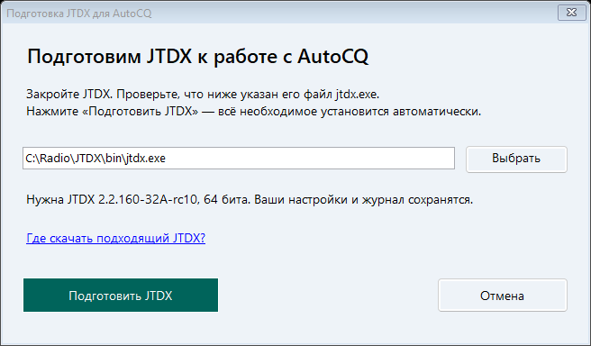
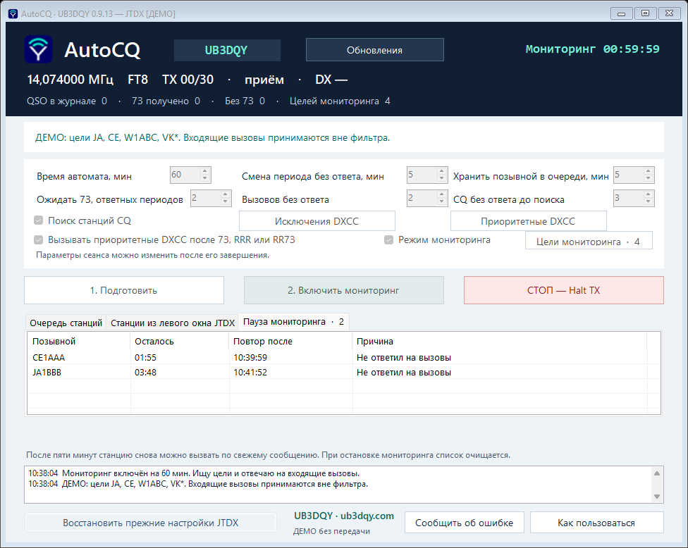
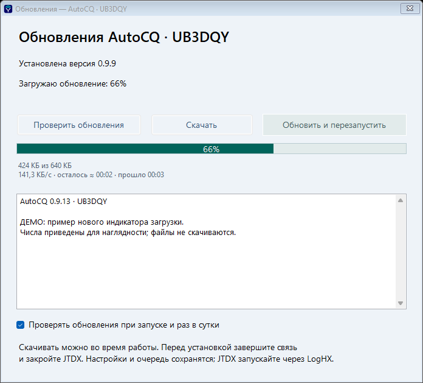
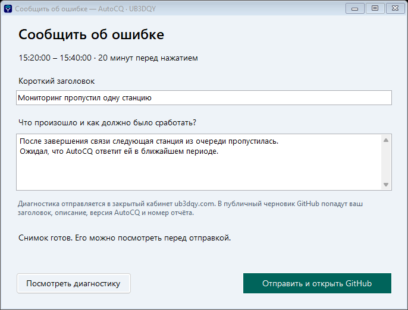

# Как пользоваться AutoCQ

Руководство для AutoCQ 0.9.13 · **UB3DQY** · [English](USER-GUIDE.en.md) · [Главная страница](README.md)

AutoCQ нужен, чтобы JTDX продолжал работать после очередной связи. Пока вы отвечаете одному корреспонденту, модуль запоминает остальных. Закончив QSO, он выбирает следующую станцию или возвращается к общему вызову. Время работы и правила выбора задаёте вы.

В режиме мониторинга программа слушает эфир и сама вызывает станции из выбранных стран или по нужным позывным. Можно выбрать другую станцию вручную, провести с ней связь и вернуться к мониторингу.

## 1. Что скачать

Нужны два архива: [JTDX 2.2.160-32A-rc10, 64 бита](https://ub3dqy.com/downloads/jtdx/2.2.160-rc10/jtdx-2.2.160-32A-rc10-win64.exe.zip) и [последний выпуск AutoCQ](https://github.com/ub3dqy/jtdx-autocq/releases/latest).

На GitHub откройте **Assets** и выберите файл **JTDX-AutoCQ-…-win64.zip**. Архивы «Source code» предназначены для разработчиков. Установите JTDX, проверьте свой позывной, звук, приём и передачу обычным способом, затем закройте JTDX.

Архив AutoCQ распакуйте через «Извлечь всё» в Проводнике. Удобно создать папку AutoCQ в «Документах». Сохраните все файлы архива вместе: рядом с программой находятся инструкция и файлы подготовки.

## 2. Подготовка и запуск

Откройте **JTDX-AutoCQ.exe**, пока JTDX закрыт. Выберите начальные параметры: для знакомства подойдут 5 минут, 2 вызова и ожидание 73 в течение 2 ответных периодов. Нажмите **«1. Подготовить»**.

Если дополнение к JTDX ещё не установлено, откроется такое окно:



Проверьте путь к установленному **jtdx.exe**. Если он неверный, нажмите «Выбрать файл» и найдите его в папке JTDX, обычно внутри **bin**. Нужна именно **2.2.160-32A-rc10, 64 бита**. Нажмите «Подготовить JTDX», дождитесь сообщения о готовности и нажмите «Продолжить». При необходимости Windows попросит разрешение изменить установленный файл.

AutoCQ сохраняет оригинальный jtdx.exe рядом с ним. Ваш позывной, звук, трансивер, журнал и настройки окна сохраняются. При следующей подготовке эта процедура уже не понадобится, если дополнение актуально.

Теперь запустите JTDX. **В связке с LogHX используйте значок JTDX в самом LogHX.** Выберите диапазон и FT8 или FT4. Через несколько секунд в AutoCQ появится частота; иногда нужно подождать до 15 секунд.

В JTDX оставьте включёнными **«АвтоTX»** и штатный **«Автовыбор»**, а **«Одиночное QSO»** — выключенным. Фильтр и очистку левого окна настройте так, как вам удобно: модуль не требует режима «Без фильтра» или постоянно заполненного окна.

Чтобы начать с CQ, очистите «Позывной DX» в JTDX и нажмите **«2. Включить автомат»** в AutoCQ.

## 3. Что видно в главном окне


Вверху показаны подключение JTDX, частота, режим, текущая станция и оставшееся время. Под ними — состояние автомата и основные параметры. Ниже находятся кнопки запуска и остановки, очередь станций, список сообщений левого окна и небольшой журнал действий.

**«СТОП — Halt TX»** останавливает автомат и посылает JTDX команду прекратить передачу. Это немедленная остановка. Для планового окончания пользуйтесь таймером.

Когда таймер истечёт, надпись **«Завершаю QSO / очередь»** означает, что модуль ещё работает: он заканчивает текущую связь и обрабатывает доступные вызовы. Станции с пометкой «Нет ответа» не удерживают сеанс. После завершения параметры снова становятся доступны.

Кнопка **«Как пользоваться»** открывает эту инструкцию без интернета. Кнопка **«Обновления»** показывает установленную версию и проверяет новые выпуски.

## 4. Основные настройки

| Поле | Что оно меняет |
| --- | --- |
| Время автомата, мин | Через сколько минут начать завершение работы. Текущая связь заканчивается до остановки. |
| Ожидать 73, ответных периодов | Сколько ответных периодов дать корреспонденту для финального подтверждения. В FT8 возможность ответа той же станции наступает каждые 30 секунд. |
| Вызовов без ответа | Сколько раз вызывать станцию, если ответа от неё нет. |
| CQ без ответа до поиска | После скольких общих вызовов искать станцию в левом окне, если включён поиск. |
| Смена периода без ответа, мин | Когда при длительном отсутствии ответов на CQ попробовать другой период передачи. |
| Хранить позывной в очереди, мин | Когда удалять устаревшие записи очереди. |

**«Поиск станций CQ»** разрешает поиск по левому окну после заданного числа общих вызовов. После неудачного вызова найденной станции модуль возвращается к CQ: общий вызов → станция → общий вызов.

Число вызовов и ожидание 73 меняйте перед «Подготовить», пока JTDX закрыт: эти параметры согласуются со счётчиками JTDX. Подсказка под полями показывает, когда изменения можно применить.

## 5. Очередь: кого вызовет программа

Станции, которые зовут вас, попадают в очередь автоматически. Если несколько станций позвали одновременно, преимущество получают те, с кем ещё не было связи на текущем диапазоне в текущем режиме. Затем учитываются приоритеты DXCC и порядок очереди.

Если станция, которую модуль только начал звать, не ответила, а другая позвала вас в этом приёмном периоде, AutoCQ отвечает вызывающей. Начавшийся обмен рапортами не прерывается ради другой станции.

Для ручного добавления введите позывной под вкладкой **«Очередь станций»** и нажмите **«Добавить»**. После текущего QSO и доступных вызывающих модуль позовёт его напрямую, без ожидания CQ или другого сообщения от этой станции. Такой вызов использует текущие период и звуковую частоту TX JTDX.

Кнопки **«Выше»** и **«Ниже»** меняют порядок, **«Изменить»** исправляет позывной, **«Удалить»** убирает запись. После лимита попыток появляется **«Нет ответа»**. Если хотите попробовать ещё раз, выделите станцию и нажмите **«Повторить»**. Завершённая связь убирает старую запись, даже если запись в журнале задержалась.

Во вкладке **«Станции из левого окна JTDX»** можно выделить свежее сообщение и нажать **«Позвать выбранную»**. Эта вкладка показывает доступные модулю сообщения, а не полный журнал эфира.

## 6. Приоритеты и исключения DXCC

В **«Приоритетных DXCC»** отметьте страны и территории, которым хотите отдавать предпочтение. Перед своим CQ AutoCQ сможет выбрать подходящую приоритетную станцию из левого окна. Галочка **«Вызывать приоритетные DXCC после 73, RRR или RR73»** разрешает выбирать её и после такого сообщения.

По прощанию выбирается **отправитель**. Например, в сообщении «AA1AA JA1BBB 73» прощается JA1BBB — он и будет кандидатом на вызов. Сообщение должно быть свежим и доступным модулю после фильтра JTDX.

В **«Исключениях DXCC»** отметьте страны, которые автомат должен пропускать. Исключение действует также на приоритеты, ручную очередь и мониторинг. Если цель не вызывается, проверьте, не находится ли она в исключениях.

## 7. Мониторинг для дипломов и нужных позывных

Откройте **«Цели мониторинга»**. Можно выбрать страны DXCC, точные позывные и маски. Достаточно совпадения с одной из выбранных целей.


Точные позывные разделяйте пробелами, запятыми или переносами строк. В масках звёздочка означает любое число знаков, а вопросительный знак — один знак: `9J*` подходит позывным с началом 9J, `K?ABC` — K1ABC или K2ABC.

Сохраните цели, включите **«Режим мониторинга»** и нажмите **«2. Включить мониторинг»**. Программа останется на приёме и будет искать свежие CQ, 73, RRR и RR73 от подходящих станций. При выборе по финальному сообщению вызывается его отправитель. После QSO или лимита вызовов AutoCQ снова слушает эфир. Общий вызов в этом режиме не передаётся.

### Если станция сама вас зовёт

Фильтр мониторинга определяет, кого модуль ищет и вызывает сам. Если станция обращается к вашему позывному, AutoCQ отвечает ей, даже если её страна, позывной или маска не выбраны. Входящий вызов имеет приоритет перед поиском новой цели и сохранённым выбором через кнопку «Позвать выбранную».


Если вы заняты, вызывающие остаются в очереди до завершения текущей связи. Финальное 73 и новый вызов могут прийти в одном периоде: программа сохранит оба сообщения и ответит следующему корреспонденту. Если выбранная вами станция ещё не ответила, а другая уже зовёт вас, модуль переключится на неё после завершения приёмного периода. Начатая передача и связь с отвечающим корреспондентом не прерываются.

Сначала выбирается станция, с которой ещё не было QSO на этом диапазоне и в этом виде работы. Среди остальных действуют приоритеты DXCC и порядок очереди. Исключения DXCC сохраняются. Для повторных вызовов уже сработанных в сеансе станций учитывается настройка JTDX «Отв. B4».

Галочка «Одна связь на цель на диапазоне» и пятиминутная пауза после неудачного поиска относятся к самостоятельному выбору целей. Ответить станции, которая сама вас зовёт, они не мешают. После QSO или лимита попыток AutoCQ проверит остальных вызывающих и вернётся к мониторингу с прежними целями и оставшимся временем. Общий вызов в этом режиме не передаётся.

Когда время истекло, модуль закончит текущую связь и обработает доступные входящие вызовы, принятые до окончания времени. Новые цели и новые входящие вызовы после этого уже не продлевают сеанс. Станции с отметкой «Нет ответа» пропускаются.

Если корреспондент пришлёт подтверждённый рапорт с задержкой, AutoCQ может продолжить обмен с ним после текущей связи. В течение пяти минут JTDX помнит время первого рапорта этой попытки и последний рапорт, который был передан именно этой станции. Эти данные используются при автоматической записи.

### Как вызвать другую станцию вручную

Если во время приёма вы заметили интересную станцию за пределами своих целей, дважды нажмите на её сообщение в левом окне JTDX. AutoCQ примет ваш выбор и продолжит сопровождать эту связь. «АвтоTX» и «Автовыбор» в JTDX должны оставаться включёнными.

Можно сделать это и из AutoCQ: откройте **«Станции из левого окна JTDX»**, выделите строку и нажмите **«Позвать выбранную»**. Подойдёт свежее CQ, 73, RRR или RR73. Если уже идёт другая связь, кнопка сохранит ваш выбор до её завершения; перед вызовом сообщение выбранной станции должно оставаться доступным.


После QSO или заданного числа вызовов без ответа AutoCQ вернётся на приём и продолжит искать ваши цели. Ничего включать заново не нужно: список целей и оставшееся время сохраняются. В журнале действий будет указано, что станция выбрана вручную.

Такой выбор разрешает одну попытку связи, даже если станция не входит в цели, цель уже выполнена или действует пауза после прежнего вызова. Исключения DXCC остаются в силе. Когда время сеанса истекло, новые ручные вызовы из модуля не запускаются; текущая связь заканчивается обычным образом.

### «Одна связь на цель на диапазоне»

Это ограничение относится к **цели**, а не ко всем станциям по отдельности. Если вы выбрали Японию и уже провели QSO с любой японской станцией на 20 м, цель «Япония на 20 м» выполнена. Другую японскую станцию на 20 м модуль пропустит. На 40 м та же страна может ещё оставаться доступной.

Если цель — точный позывной, проверяется связь с ним. Для маски выполненной считается цель, которой соответствует проведённая связь. Учитывается журнал JTDX, в том числе предыдущие сеансы. Чтобы работать с несколькими станциями одной страны на том же диапазоне, снимите галочку.

### Станции, которые не ответили

Во вкладке **«Пауза мониторинга»** видны станции, которым AutoCQ пока не будет повторять вызов. Сюда попадают и вызовы, прерванные JTDX из-за занятой частоты или ответа корреспондента другой станции. В таком случае мониторинг продолжается с прежним временем окончания. Для каждого позывного видны оставшееся время и время окончания паузы.



Пауза длится пять минут после неудачной попытки. Когда она закончится, строка исчезнет, и AutoCQ сможет снова выбрать станцию по новому свежему сообщению. Само истечение времени не запускает передачу. Кнопка «Снять отметку попытки» во вкладке левого окна позволяет попробовать раньше.

При остановке мониторинга, в том числе по таймеру, список и его паузы очищаются. Выключение галочки «Режим мониторинга» также сбрасывает их. Другие записи и проведённые связи сохраняются.

## 8. Обновление программы


При запуске и раз в сутки AutoCQ проверяет новые выпуски на GitHub. Если версия новее установленной, появится уведомление и выделится кнопка «Обновления». Проверку можно выключить галочкой в этом разделе. Она обращается к публичным файлам проекта; настройки, позывной и журнал никуда не отправляются.

Нажмите **«Проверить обновления»**, затем **«Скачать»**. Это можно делать во время работы. Перед установкой закончите связь и закройте JTDX. Нажмите **«Обновить и перезапустить»**. AutoCQ проверит архив, заменит свои файлы, при необходимости обновит дополнение для JTDX и откроется снова. Если Windows запросит разрешение, подтвердите его. LogHX можно оставить открытым. После обычной подготовки запустите JTDX из LogHX.

Очередь и настройки сохраняются. При ошибке замены установщик пытается вернуть предыдущие файлы; резервная копия остаётся в папке загруженного обновления.

### Как понять, что загрузка идёт

После нажатия «Скачать» сначала появляется сообщение о подготовке и подключении к серверу. Когда файл начнёт поступать, шкала будет заполняться. В окне видны процент, уже скачанный и полный объём, скорость, примерное оставшееся и прошедшее время.



Оставшееся время рассчитывается по текущей средней скорости и может меняться. Если данные перестали поступать, появится сообщение об ожидании сервера. Если полный размер неизвестен, программа покажет скачанный объём и прошедшее время без выдуманного процента.

100% означает, что файл получен целиком. Затем AutoCQ покажет «Проверяю архив» и «Подготавливаю файлы обновления». Кнопка установки станет доступна после успешной проверки. При обрыве или ошибке проверка не считается завершённой: можно повторить скачивание.

В версиях до 0.9.6 кнопки обновления нет. Для первого перехода закройте JTDX и AutoCQ, извлеките новый ZIP в папку AutoCQ с заменой файлов и откройте новую программу. В дальнейшем пользуйтесь встроенным разделом.

## 9. Если что-то не получается

**В AutoCQ нет частоты или не включается автомат.** Закройте JTDX, нажмите «1. Подготовить», затем запустите тот же JTDX через LogHX. Подождите до 15 секунд. Если AutoCQ сообщает о другой сборке, нужна 32A-rc10 Win64.

**Цель видна слева, но её не зовут.** Проверьте DXCC, точный позывной или маску, исключения и галочку «Одна связь на цель на диапазоне». В мониторинге подходят CQ, 73, RRR, RR73. После неудачных вызовов действует пятиминутная пауза для этой станции. Чтобы попробовать раньше, выделите её во вкладке левого окна и нажмите «Снять отметку попытки». Во время текущего QSO новая цель ждёт окончания связи.

**Время вышло, а параметры ещё неактивны.** Посмотрите состояние: «Завершаю QSO / очередь» означает, что сеанс ещё заканчивается. Для немедленной остановки есть «СТОП — Halt TX».

**После остановки модуль показывает передачу JTDX.** Проверьте собственные «АвтоTX» и «Автовыбор» в JTDX: модуль отображает и ручную или штатную передачу. Для немедленного прекращения используйте «Стоп Tx» в JTDX.

**GitHub недоступен.** Работа в эфире не зависит от проверки обновлений. Попробуйте проверку позднее или скачайте выпуск вручную.

Для обычной работы без AutoCQ закройте JTDX, затем нажмите **«Восстановить прежние настройки JTDX»**. Это восстанавливает параметры подключения и счётчиков; дополнение в jtdx.exe остаётся. Команда для полного снятия дополнения описана ниже для опытных пользователей.

## 10. Автор и обратная связь

AutoCQ разрабатывает радиолюбитель **UB3DQY**. Чтобы посмотреть версию и ссылки на проект, нажмите **UB3DQY** в шапке главного окна. Откроется окно **«О программе»**. Оно также доступно из меню значка AutoCQ рядом с часами Windows.


Ссылка **«UB3DQY · ub3dqy.com»** внизу главного окна ведёт на [сайт автора](https://ub3dqy.com/). В окне «О программе» можно также открыть [описание модуля](https://ub3dqy.com/ru/read/5/) и исходники на GitHub.

### Как отправить отчёт об ошибке

1. Нажмите **«Сообщить об ошибке»** внизу главного окна, как только заметите сбой. AutoCQ запомнит 20 минут перед нажатием. Это можно сделать прямо во время работы.
2. Дайте отчёту короткий заголовок и своими словами опишите, что произошло и что вы ожидали. Кнопка **«Посмотреть диагностику»** откроет события AutoCQ и JTDX, версии программ и состояние очереди. В событиях могут быть позывные, время и частоты.
3. Нажмите **«Отправить и открыть GitHub»**. Диагностика попадёт в закрытый кабинет команды на ub3dqy.com. В GitHub откроется черновик с вашим описанием и номером отчёта. Проверьте текст и опубликуйте Issue. Для публикации понадобится аккаунт GitHub.



Если связь с сайтом прервалась, повторите отправку в том же окне. Снимок останется тем же. Если описание длинное, AutoCQ скопирует его с номером отчёта. Вставьте этот текст в черновик сочетанием **Ctrl+V**.

[Создать Issue вручную или предложить функцию](https://github.com/ub3dqy/jtdx-autocq/issues/new/choose) · [Вопросы и обсуждения](https://github.com/ub3dqy/jtdx-autocq/discussions) · [Статья на сайте](https://ub3dqy.com/ru/read/5/)

## Для опытных пользователей: снять дополнение JTDX

При закрытом JTDX из папки AutoCQ выполните:

```powershell
.\JTDX-AutoCQ-Patch.exe --jtdx "C:\JTDX64\160-32A-rc10\bin\jtdx.exe" --restore
```

Укажите свой путь. Утилита проверит резервную копию `jtdx.exe.autocq-original` и восстановит оригинал. Этот шаг нужен только для полного возврата исходного исполняемого файла.
